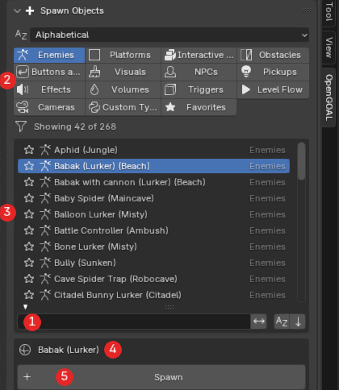
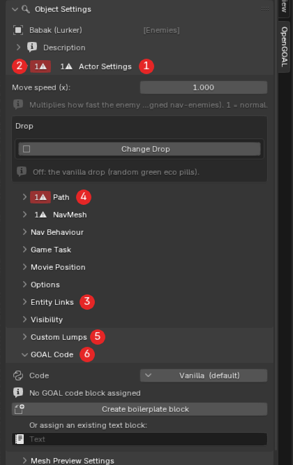

# Actors

An **actor** is anything in the game that does something: enemies, platforms, doors, NPCs, power cells, orbs, crates, particle effects. In Blender every actor is an **empty** named `ACTOR_<etype>_<n>` (for example `ACTOR_babak_0`). Its settings live on the empty and are written to the level's `.jsonc` file when you export.

This page covers placing actors and the settings every actor shares. Paths and moving platforms are on [Paths & platforms](paths-and-platforms.md), enemies and nav-meshes on [Enemies & nav-meshes](enemies-and-navmesh.md). There is a list of all 258 spawnable actors on the [Actor list](actor-list.md) page.

## Spawning an actor

1. Put the **3D cursor** where the actor should go (Shift + right-click in the viewport).
2. Open **OpenGOAL › Spawn Objects**.
3. Find the actor: type in the search field (① in the Spawn Objects screenshot), or click a category tile (②).
4. Click it in the list (③). A box opens under the list with its name, the **Spawn** button (⑤), a **Description**, and any choices to make before spawning, such as a **Variant** (④).
5. Click **Spawn**. The new empty is placed at the 3D cursor and selected.

The message bar says what the actor still needs. For example: "needs a path", "link it to a nav-mesh", or "prop — idle animation only, no AI/combat".

### Search, tiles and favourites

- **Search** looks at the actor's name, its texture group (typing `beach` finds every Sentinel Beach actor) and its etype (`babak` finds "Babak (Lurker)", and so does `ram boss` for `ram-boss`).
- **Category tiles**: click a tile to show only that category. Click it again to show everything. **Shift+click** adds or removes a tile, so you can show several categories at once. While a filter is on, a line under the tiles says "Showing N of M".
- **Favorites**: click the star at the start of any row to mark it. The **Favorites** tile then shows only your starred items. Favourites are saved in the .blend.
- **Sort** (the drop-down above the tiles): **Alphabetical**, or **Tpage Group** to group the actors by the game world their textures come from (Beach, Jungle, ...).

Each row shows the actor's name, its texture group in brackets, and its category on the right.

The tiles are: Enemies, Platforms, Interactive Objects, Obstacles, Buttons and Doors, Visuals, NPCs, Pickups, Effects, Volumes, Triggers, Level Flow, Cameras, Custom Types, Favorites. Volumes, triggers, checkpoints and cameras are not actors. They have their own pages: [Volumes & triggers](volumes-and-triggers.md) and [Checkpoints & cameras](checkpoints-and-cameras.md).

### Choices before spawning

Some items show extra fields in the box under the list:

| Field | For | What it does |
|---|---|---|
| **Variant** | Actors with several looks or kinds (crates, bridges, particle files, ...) | Which one to spawn. Some variants add a second **Option** list (for example a particle file's groups). You can change it later in Actor Settings. |
| **Crate type** | Crates | The crate's look and strength. |
| Sound picker | Sound emitters | The sound to play (see [Audio](audio.md)). |
| **Deftype name** | Custom type | The name of your own GOAL type (see [Edited actors & GOAL code](edited-actors-and-goal-code.md#your-own-types)). |
| Info lines | Some actors | "Needs 2 paths (path + pathb)", "Needs waypoints to patrol", "Prop — idle animation only", "Nav-enemy, needs navmesh and path". |

### From the Add menu

In the 3D viewport, press **Shift+A** and pick **OpenGOAL Object** at the bottom of the menu. A search opens with every actor. Actors with variants are listed once per variant, as "Actor — Variant". Pick one and it is added at the 3D cursor.

### Connecting to the selection

The add-on preference **Connect spawned actors to the selection** is on by default. When you spawn an actor, it gets linked to what was selected before you clicked Spawn:

- selected **curves** become its path (if it uses a path),
- a selected **nav-mesh** becomes its nav-mesh. If you selected an actor that already has a nav-mesh, the new actor links to that actor through **nav-mesh-actor** instead,
- a selected `VOL_` **volume** becomes its volume (if it uses one).

The message bar lists what was connected. Turn the preference off in **Edit › Preferences › Add-ons › OpenGOAL Level Tools** if you don't want this.

## The actor empty

Each actor is drawn as an empty with a shape and colour from the add-on's database (cube for platforms, sphere for most others, and so on). The colour shows the category. Custom types are small and yellow-green. Some actors whose rotation matters also show their axes. Some actors can only be turned around certain axes, and Blender locks the others for you.

You can move, rotate and scale the empty like any object. The empty's scale is exported for actors that read it, and whenever it isn't 1.

### Preview models

With the add-on preference **Preview Models** on (the default), a spawned actor gets a copy of its game model as a child, so you can see its size and look in the viewport. Waypoints of an actor get a see-through "ghost" of its model too. The models come from the game files the add-on extracted. If there is no model, the message bar says "No GLB for <etype>".

Other preferences for previews:

- **Select actors by their preview model** (on by default): clicking the model selects the actor. Turn it off to select the preview meshes themselves.
- **Snapping skips the moved actor's preview** (on by default): while you move an actor with snapping on, it doesn't snap to its own model. Other actors' models can still be snapped to.

**OpenGOAL › Object Settings › Mesh Preview Settings** (with the actor or its preview selected):

| Option | What it does |
|---|---|
| **Refresh Model** | Rebuilds the preview from the actor's current variant and resets the offset. |
| **Preview Offset** | Moves the preview away from the actor's centre (only in Blender, not in game). |
| **Override Mesh** | Shows this mesh instead of the actor's model. Leave it empty for the automatic one. |

Some actors have a bigger special preview, such as the platform grid, race rings or extra models. These panels end with a **Show preview** checkbox. Turn it off and that preview is not built or updated, which helps in large scenes.

## Actor settings

Select an actor and open **OpenGOAL › Object Settings**. The top shows the actor's name and category. A collapsed **Description** says what the actor is and how it behaves. The settings sit in sub-panels:

- **Actor Settings** (① in the Actor screenshot): the actor's own fields, with more sub-panels inside it (see below).
- **Custom Lumps**: extra raw data for the actor and the **Export as** field.
- **GOAL Code**: edited code and your own code blocks ([Edited actors & GOAL code](edited-actors-and-goal-code.md)).
- **Mesh Preview Settings**: see above.

### Where the fields come from

The add-on has no hand-made panel for every actor. It reads the game database (`jak1_game_database.jsonc`) to decide which fields and sub-panels an actor shows. An actor gets the panels listed on its own record and on its **parents** (the GOAL types it inherits from). For example, every floating platform gets **Sync** from `plat`. Each field has a label, a default value, and often a grey note under it that explains what it does and what the game does with it.

How the fields work:

- Choice fields show radio buttons, or a searchable drop-down when the list is long.
- On/off fields are toggle buttons.
- **Alt+click** a choice or toggle to set it on every selected actor that has the same field, the way Alt works on normal Blender properties.
- Game task fields open a search with every game task and your own tasks, plus **Custom…** to type a name ([Tasks](tasks.md)).
- Object fields (an empty or a camera the actor uses) have **Pick** / **Change**, a clear button (X), and for empties **Add Empty at Cursor**.
- Colour fields show **Set colour** until you set one.
- Height fields can have **Set to this actor's height**.
- Some fields are grouped in a collapsed sub-menu with a title.

### ⚠ counts

A panel header shows a **red count** (for example `2⚠`, ② in the Actor screenshot) when the actor is missing something it needs: a required field, a link, or a path. A **yellow count** is a soft warning: it works, but does less than you probably want. Hover the count to see the list, or click it to open a popup where you can fill in what's missing. A missing required field also shows a red "Required: ..." line in the panel. See [The interface](interface.md#warnings-the--counts-and-level-audit) for how warnings work everywhere.

### Sub-panels of Actor Settings

Which sub-panels you see depends on the actor. The ones about this actor alone come first (Crate, Launcher Settings, Eco Door Settings, Platforms, Battle Controller, ...). The general ones follow in this order:

| Sub-panel | What it's for | Covered on |
|---|---|---|
| **Sync** | Timing of a moving platform along its path | [Paths & platforms](paths-and-platforms.md#sync) |
| **Path** | Waypoints and curves | [Paths & platforms](paths-and-platforms.md) |
| **Volume** | A trigger volume the actor uses | [Volumes & triggers](volumes-and-triggers.md) |
| **NavMesh**, **Nav Behaviour** | Enemy pathfinding, activation, aggro triggers | [Enemies & nav-meshes](enemies-and-navmesh.md) |
| **Game Task** | The task the actor belongs to (cells, flies, NPCs) | [Tasks](tasks.md) |
| **Movie Position** | Where a power cell plays its pickup animation | below |
| **Options** | The actor's option flags | below |
| **Entity Links** | Links to other actors | below |
| **Visibility** | Draw distance | below |

## Entity Links

Many actors work together with other actors: a button opens a door, eco platforms wake each other up, an orbit platform needs a partner. These connections are **entity links**. In the `.jsonc` they are lumps such as `alt-actor`, `next-actor`, `prev-actor` or `water-actor`.

**Object Settings › Actor Settings › Entity Links** (③ in the Actor screenshot) shows one box per link name, with one row per **slot**:

- `[0] Partner orbit-plat *`: the slot number, then what the slot is for. `*` means **required**: without it the panel shows "Required — not set" in red and a red ⚠ count.
- `[0+] ...`: the `+` means the slot **allows multiple** actors (a list).

To link an actor:

1. Select the actor to link, then **Shift+click** the actor you're editing so it is the active one. (Or skip this and use the search.)
2. In the slot, click **Link → ACTOR_...**. You get one button per shift-selected actor (up to 6).
3. Or click **Search actor…** and pick any actor by name.

A linked slot shows the target with a check mark, a magnifier to select and frame it, and **X** to clear it. A type the slot doesn't expect still links, but is marked "(unexpected type)" and a line says what is expected. The **?** button next to the search lists every actor type that works in that slot.

For slots that allow multiple actors:

- **Add → ACTOR_...** adds one actor to the list.
- **Add all N selected (name order)** adds every shift-selected actor at once.
- **Edit order** opens a dialog: drag the grips, or select a row and use the arrows.

For `prev-actor` / `next-actor` chains, **Chain N selected by name (prev / next)** links the whole selection in outliner order: each actor gets the one before it and the one after it. **Edit order** lets you change the order first.

A few slots (for example the dark plant's neighbours) have **Connect all**. Select several of these actors, set **Max distance** and **Max links**, and each one is linked to its closest selected neighbours. The active actor's game task is copied to all of them.

**Other links** (collapsed at the bottom) holds the general slots every actor has, such as `alt-actor`, `prev-actor`, `next-actor` and `nav-mesh-actor`, when this actor isn't known to use them. They are there for code that reads them in less obvious ways.

## Options

**Actor Settings › Options** holds the actor's option flags (the `options` lump, from the game's `fact-h.gc`): for example **Has power cell** (drops a cell when killed), **Wrap phase** (for platforms) or **Vent blocked**.

- **For this actor**: the options this actor's code is known to read.
- **Other options**: more options this actor shows.
- **All options (N more)**: every other flag, collapsed. Actors can use options in less obvious ways (for example through the pickups they spawn).

## Visibility

**Actor Settings › Visibility** › **Vis distance (m)**: beyond this distance the actor stops being drawn. `-1` (the default) means the engine default.

## Movie Position

Power cells, and actors that give a power cell, have **Movie Position**: where the cell plays its pickup animation. It is an arrow (cone) empty. Its rotation is the direction Jak faces.

| Button | What it does |
|---|---|
| **Add Position** | Adds a cone empty at the 3D cursor (or at the actor with **At Actor Position** on). |
| **Link → <empty>** | Uses a shift-selected empty. |
| **Search empty…** | Picks any empty by name. |
| X | Removes the position from the list (the empty stays). |
| **Victory animations not to use (movie-mask)** | 8 toggles. Turn on the animations the cell must not pick (for example one that clips through a wall). |

With no position set, the game uses its default spot. Some actors use several positions by number, so the list order matters.

## Game Task

The **Game Task** sub-panel sets which task the actor belongs to (for example which power cell it gives). See [Tasks](tasks.md).

## Custom Lumps

A **lump** is one named value in an actor's `.jsonc` entry (`"vis-dist"`, `"alt-actor"`, `"options"` ...). The panels write the lumps they know about. **Object Settings › Custom Lumps** (⑤ in the Actor screenshot) lets you add any other lump by hand.

1. Click **Add**.
2. Type the **Key** (the lump name), pick the **Type**, and type the **Value**. Separate several values with spaces.
3. A row with a problem shows a red dot, and a line under the list says what's wrong ("empty value", "not valid JSON ..."). If your key is one the add-on writes itself, a note says that your row overrides the add-on's value.

**Remove** deletes the selected row.

| Type | Value |
|---|---|
| `float` | Plain numbers, e.g. `4.0 0.0 0.15 0.15` |
| `meters` | One distance in metres |
| `degrees` | One angle in degrees |
| `int32` / `uint32` | Whole numbers (signed / unsigned) |
| `enum-int32` / `enum-uint32` | A GOAL enum, e.g. `(game-task village1-yakow)` or `(fact-options has-power-cell)` |
| `vector4m` | `x y z w`, each in metres |
| `vector3m` | `x y z` in metres (w = 1) |
| `vector-vol` | `x y z radius_m` |
| `vector` | `x y z w` with no unit scaling |
| `movie-pos` | `x y z rot_deg` |
| `water-height` | `water wade swim flags [bottom]` |
| `eco-info`, `cell-info`, `buzzer-info` | Pickup data, e.g. `(game-task none)` or `(game-task none) index` for a scout fly |
| `symbol` | A GOAL symbol, e.g. `thunder` |
| `string` | Text, several separated by spaces |
| `type` | A GOAL type, e.g. `process-drawable` |
| `plain-text` | Written to the `.jsonc` exactly as typed (must be valid JSON) |

### Lump Reference

**Custom Lumps › Lump Reference** lists the lumps the add-on knows for this actor. They are grouped as "(this actor)" and "From parent: ..." with their type and a description. Click **+** on one to add it as a Custom Lumps row.

### Export as

The **Export as** field at the top of Custom Lumps exports the actor as another etype, for example your own child type of it. Everything else (its settings, art group, code and textures) stays the spawned actor's. Leave it blank to use its own etype. This is mainly for [your own GOAL types](edited-actors-and-goal-code.md#export-as).

## Export As: a mesh full of actors

Select a plain mesh (not an actor, volume or nav-mesh) and open **Object Settings › Export As**. Search for an entity type and click it. At export, **every vertex** of the mesh becomes one actor of that type, using the mesh after its modifiers. Add an Array, Subdivision or Curve modifier to change how many there are and where they go, without touching the mesh. The panel shows how many actors you'll get. The mesh moves to the level's **Export As** collection. The X button clears it.

Only pickups (orbs, scout flies, ...) and props (actors that only play an idle animation) are offered here.

## Object Controls tools

**OpenGOAL › Object Controls** works on the whole selection, actors or not. Its top row has **Frame**, **Duplicate** and **Delete**. Under it is a collapsed summary of what's selected, by kind, where you can keep or drop a kind or a single object.

### Duplicating and deleting actors

Duplicate actors with Blender's own **Shift+D** or with **Duplicate** in Object Controls. Copies get proper names (`ACTOR_babak_3` instead of `ACTOR_babak_0.001`) and their own preview model. Deleting an actor (X or **Delete**) also deletes its preview and helper empties, and removes the volume links that pointed at it.

### Convert Entities

Changes the selected actors into another actor type, keeping where they are.

1. Pick **Convert**:
   - **Actors only**: the selected actors.
   - **Actors and empties**: plain empties become actors too.
   - **All objects**: meshes, curves and so on are replaced by actors too. Those objects are **deleted** (the panel warns in red).
2. **Target actor**: click **Pick…** and search for the type.
3. Click **Convert N ... to <type>**.

The new actors get fresh names, as if spawned, and updated previews. Paths, links, nav-meshes and every setting that still applies are kept. Links from other actors to the old ones point to the new ones.

### Set to Floor

Drops the selected objects onto the ground below them.

| Option | What it does |
|---|---|
| **Distance** | Height above the ground (e.g. floating orbs). |
| **Search from above** | The ground search starts this far above the object, so an object slightly under the ground still finds it. |
| **Align to floor** | Tilts the object so it follows the slope. |
| **Meshes** | For meshes: **Lowest vertex** or **Origin** goes on the ground. |
| **Set N to Floor** | Does it. Volumes, nav-meshes, previews and the selection itself are never treated as ground. |

### Distribute Along Curve

Places the selected objects along a curve. See [Paths & platforms](paths-and-platforms.md#distribute-along-curve).

### Export Selected Definitions

Writes the selected actors, cameras, checkpoints and load boundaries the way the level files would. This is handy for pasting them into another level or a hand-written file. Actors and cameras give `.jsonc` entries plus the art groups and code they need (`.gd`). Checkpoints go to `level-info.gc`, load boundaries to `load-boundary-data.gc`.

| Option | What it does |
|---|---|
| **Write to** | A file (rewritten each time) or a folder (a new dated file each time). Empty: clipboard only. |
| **Add comments** | The `;;` lines saying what each part is and where it goes. |
| Format | **Bracket & category** (`"actors": [ ... ]`), **Bracket** (`[ ... ]`), or **No brackets** (only the entries, to paste between other entries). |
| **End with a comma** | With No brackets: a comma after the last entry. Turn it off when pasting as a list's last entry. |
| **Indentation offset** | Extra indentation in steps of 2 spaces. At 1, entries line up inside a level file's `"actors"` list. |
| **Export N Definition(s)** | Exports. The text is always copied to the clipboard as well. |

---
[← Previous](geometry.md) · [Guide index](README.md) · [Next →](paths-and-platforms.md)
