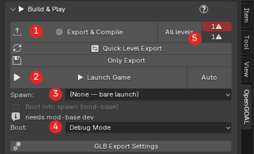

# Build & Play

The **Build & Play** panel turns your Blender scene into game files, compiles them and starts the game at one of your checkpoints. It's the first panel on the **OpenGOAL** tab.

## The usual loop

1. Click **Export & Compile** (① in the Build & Play screenshot). Blender's status bar shows the progress; the end message says how much was rebuilt and how long it took.
2. Pick a checkpoint in **Spawn** (③), for example `my-level-start`.
3. Click **Launch Game** (②). The game starts and Jak appears at the checkpoint.

You don't have to wait for the compile: click **Launch Game** while it's running and the button changes to **Launch Game (after compile)**. The game then starts as soon as the compile has finished (click again to cancel). To always launch after a compile, turn on **Auto** next to the button.

For small changes to your own level, **Quick Level Export** is faster (see below).

## Buttons and options

| Button / option | What it does |
|---|---|
| **Export & Compile** | Exports the active level's `.glb`, writes all its files and its entries in the shared game files, then compiles with GOALC. Use it after adding a new kind of actor, changing checkpoints, load boundaries, nav-meshes or level settings, and whenever you're not sure. |
| **All levels** | The same for every level in this `.blend`, with a single compile at the end. |
| **⚠ count** (⑤) | The level's warnings: red = required fields missing, grey = soft warnings. Hover to read them, click to see the list. See [The interface](interface.md#warnings-the--counts-and-level-audit). |
| **Quick Level Export** | Exports only the level's own files (`.glb`, `.jsonc` with actors, cameras and settings, `.gd`, level code) and compiles. It doesn't touch checkpoints, load boundaries, nav-mesh entries or `game.gp`. Use **Export & Compile** after changing those or adding a new actor type. |
| **Only Export** | Writes all of the level's files like **Export & Compile**, but doesn't compile. |
| **Launch Game** | Closes a running game and starts it again, so the latest build is loaded. With a checkpoint picked in **Spawn**, it then loads your level and puts Jak there. |
| **Auto** | Launch the game automatically after every compile that succeeds. |
| **Spawn** | Where Jak starts: **(None — bare launch)** or one of the active level's checkpoints, named `<level>-<checkpoint>` (`start` first). The list only shows checkpoints that exist. |
| **Boot into spawn (mod-base)** | mod-base only. See [Start checkpoint](#start-checkpoint). On other OpenGOAL kinds it's greyed out with the reason under it. |
| **Boot** (④) | How the game starts: **Debug Mode**, **Debug Mode (attached debugger)** or **Retail Mode**. See [Boot modes](#boot-modes). |
| **GLB Export Settings** | Opens the glTF exporter of the level's Geometry collection (**Properties › Collection › Exporters**). Draco compression and the other glTF options are set there. |
| **Move to Geometry** | Only shown when some of the level's meshes are outside the Geometry collection (they aren't exported). Moves them to **Geometry › Solid**. |

If the panel says **Missing paths — open Developer Tools**, the add-on can't find `gk`, `goalc` or `game.gp`. See [Install](install.md#point-the-add-on-at-opengoal).

## What a build writes

An export writes the level's own files:

- `custom_assets/jak1/levels/<level>/`: `<level>.glb` (geometry and collision), `<level>.jsonc` (actors, cameras, settings) and `<nick>.gd` (the list of files the level loads)
- `goal_src/jak1/levels/<level>/<level>-obs.gc`: the level's generated GOAL code

and, for **Export & Compile**, the level's entries in shared files: `game.gp`, `engine/level/level-info.gc` (level settings and checkpoints), `engine/level/load-boundary-data.gc`, `engine/entity/entity.gc` (nav-meshes) and, if you made [custom tasks](tasks.md), the task files. Each file is only written when its content changed.

**Developer Tools › Quick Open** has buttons that open these files and folders. **Developer Tools › Clean Files** deletes the level's generated files (it lists them and asks first) so the next build writes them from scratch.

## GOALC

GOALC is OpenGOAL's compiler. The first time you compile, the add-on starts it in its own console window. **Leave it running.**

- A freshly started GOALC compiles all the game's code on its first build (it has to load every type). That first build is slow. A GOALC that's already running only rebuilds what changed, which is much faster.
- The add-on restarts GOALC by itself when it must: when your level's own types changed (GOALC would otherwise fail with "Inconsistent type definition") or when you switch the nav-mesh system.
- **Restart it yourself** by closing the GOALC window: once after updating the add-on, and whenever GOALC seems stuck. The next **Export & Compile** starts a new one.
- **Launch Game** with a spawn needs GOALC (it sends the spawn command through it). If GOALC isn't running, do an **Export & Compile** first.

## Full engine compiles

Some shared files are part of the game's engine: `entity.gc`, `level-info.gc`, `load-boundary-data.gc`, `vol-h.gc` and `drawable.gc`. When a build changes one of them, the engine is recompiled from that file on, which takes longer. The status message then says **engine changed (…) — full compile**; otherwise it says **level only**.

This happens when:
- you change checkpoints or level settings (`level-info.gc`), load boundaries (`load-boundary-data.gc`) or nav-mesh entries (`entity.gc`)
- the add-on adds its small engine fixes the first time (`vol-h.gc`), or the first time you build a level with an Actor Light (`drawable.gc`)
- it's the first build after GOALC started (all game code, see above)
- it's the first build after updating the add-on

Changes to `game.gp` and `mod-settings.gc` don't cause a full compile. **Quick Level Export** never touches the engine files, so it stays "level only".

## Start checkpoint

**Spawn** decides where Jak starts:

- **(None — bare launch)**: the game starts normally (in debug mode it starts in the default level); go to your level yourself with the debug menu.
- **A checkpoint**: after the game has booted, the add-on connects to it through GOALC and starts it at that checkpoint. The checkpoint knows its level, so this loads your level and spawns Jak.

On **mod-base** you can turn on **Boot into spawn (mod-base)** (it's on by default). The build then writes the picked checkpoint into `engine/mods/mod-settings.gc`, and the game boots straight into it instead of teleporting Jak after booting. Because it's written at build time, pick the checkpoint *before* you compile. If you pick another one afterwards, **Launch Game** falls back to the normal teleport.

If the spawn is sometimes missed, or Launch Game hangs at "Waiting for version…", give the game more time to boot: **Developer Tools › Addon Settings › Launch Timing**:

| Setting | Default | What it does |
|---|---|---|
| **GK Boot Wait (s)** | 4 | Seconds between starting the game and the first command. Raise it on slower machines. |
| **Listener Settle (s)** | 2 | Seconds between connecting and sending the spawn. |

## Boot modes

| **Boot** | What happens |
|---|---|
| **Debug Mode** | The default. The game runs in debug mode, with the debug menus, and the spawn is sent as described above. |
| **Debug Mode (attached debugger)** | The game waits at startup; GOALC attaches its debugger and then boots the game. If the game crashes while loading your level, it stops in the debugger and the GOALC console shows where. Use it to hunt crashes. |
| **Retail Mode** | The game starts without debug mode, the way players will see it. A retail game has no connection to GOALC, so no spawn is sent: to start in your level, set **Level › Settings › Project Settings › Retail Boot Checkpoint** (see [Levels](levels.md)). |

## Logs

- **Blender's status bar** shows each step while it runs; the final message (**Build complete! (…)**) says what was rebuilt, how long it took and the slowest steps.
- **The GOALC window** shows the compile itself. When a compile fails, the error is there.
- **Blender's system console** gets the add-on's own log, each line starting with `[OpenGOAL]`: what was written, what was skipped, what changed. On Windows: **Window › Toggle System Console**.
- **Developer Tools › Quick Open › Game logs** opens OpenGOAL's `log` folder, with the compiler and game logs.

## Export filter

**Developer Tools › Addon Settings › Build Settings › Export Filter** lets you leave parts out of the export, for testing or special setups. Turn on **Filter exports**, then untick what to skip.

| Part | What it is |
|---|---|
| **Geometry (GLB)** | The level's `.glb` (geometry and collision) |
| **Entities (.jsonc)** | Actors, ambients, cameras, art groups |
| **Load (.gd)** | The level's file list |
| **Actor code (-obs.gc)** | The level's generated GOAL code |
| **game.gp definition** | The level's build and code entries in `game.gp` |
| **Nav-mesh (entity.gc)** | The level's nav-mesh entries in `entity.gc` |
| **Task & Menu** | Custom tasks: task list, task file, texts |
| **Level settings** | `level-info.gc`: everything but the checkpoints |
| **Checkpoints** | `level-info.gc`: the checkpoints |
| **Load Boundaries** | `load-boundary-data.gc` |
| **Project settings** | **Level › Project Settings**: the boot, New Game and Quit checkpoints and the Discord status (off: those files aren't touched) |

Skipped parts are logged in the system console. **Skipping parts can break the compile and crash the game**, and the panel header shows **(on)** while the filter is active, so remember to turn it off again.

## Common build errors

| Message | What to do |
|---|---|
| **Enter a level name first** | There's no active level, or it has no name. Create one in **Level › Level Manager**. |
| **Level name '…' is N chars — max 10** | Shorten the name in **Level › Settings**. |
| **GLB export failed: …** | The geometry couldn't be exported. Read the rest of the message; check the meshes in Geometry and **GLB Export Settings**. |
| **GOALC failed to start: …** | `goalc` wasn't found or wouldn't start. Check the paths in **Developer Tools › Paths**. |
| **Compile failed — see the GOALC console** | GOALC hit an error. The GOALC window says what and where. Errors in your own GOAL code show up here too. |
| **Compile didn't finish (GOALC closed or timed out)** | GOALC was closed or got stuck. Close its window if it's still open and compile again. |
| **GOALC isn't running. Run Export & Compile first…** | **Launch Game** with a spawn needs GOALC. Compile once, then launch. |
| **Tasks: …** | A custom task has a problem. See [Tasks](tasks.md). |
| **N mesh(es) outside Geometry aren't exported** | Click **Move to Geometry**, or move them into the level's Geometry collection. |
| The game loads but Jak doesn't appear at the checkpoint | Raise **GK Boot Wait (s)** (see [Start checkpoint](#start-checkpoint)). |
| Old changes still show up, or strange compile errors after renaming things | **Developer Tools › Clean Files**, then **Export & Compile**. |

More problems and their fixes: [Troubleshooting](troubleshooting.md).

---
[← Previous](interface.md) · [Guide index](README.md) · [Next →](levels.md)
