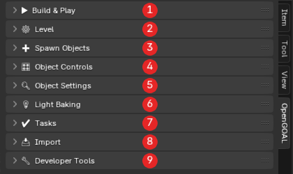

# Developer Tools

The **Developer Tools** tab (⑨ in the [sidebar screenshot](images/sidebar.png)) holds the add-on's paths, build
options, version checks and shortcuts to the generated files. Most people only need it when something isn't found or
when they work on several projects. The parts marked *advanced* can break a build if set wrong.

At the top is **Clean Files**. Under it are three closed sub-menus: **Paths**, **Addon Settings** and **Quick Open**.

---

## Clean Files

**Clean Files** deletes the files the add-on generated for the active level, so the next build writes them all fresh:

- `goal_src/jak1/levels/<level>/<level>-obs.gc` (the level's code)
- `custom_assets/jak1/levels/<level>/<level>.jsonc` and `<level>.glb`
- every `.gd` file in that folder

A dialog lists the files first; click **Delete** to go ahead. Use it when a build keeps failing on old, stale files.
Your .blend isn't touched.

---

## Paths

### Status

Three lines show whether the add-on finds `gk`, `goalc` and `game.gp` (**✓ OK** or **✗ NOT FOUND**). If one is missing,
**Build & Play** also shows **Missing paths — open Developer Tools**. **Set EXE / Data Paths** opens the add-on
preferences, where the OpenGOAL folders are set (see [Install](install.md)).

### Where the add-on looks

Each folder is taken from the first of these that is set:

1. This .blend's **Project Folders** (below), when **Use this .blend's folders** is on.
2. The preferences' manual overrides (**Preferences › Manual path overrides (advanced)**).
3. The preferences' auto-detected install (**OpenGOAL Root** + the picked executables / data folder).

### Project Folders (this .blend)

Folders saved inside the .blend file. They win over the preferences while this file is open, so each project can
use its own OpenGOAL install (a release for one, a mod-base clone for another) without changing the preferences.
Empty fields fall back to the preferences.

| Option | What it does |
|---|---|
| **Use this .blend's folders** | Turns the folders below on. Off: the preferences are used. |
| **EXE folder** | The folder with `gk` / `goalc`. Dev clone: `<repo>/out/build/Release/bin`. |
| **Data folder** | Release install: the parent of `data/`. Dev clone: the repository root. |
| **Decompiler output** | `decompiler_out/jak1/` (used by [Importing](importing.md)). Blank: `<data>/decompiler_out/jak1`. |
| **Custom code folder** | Your own edited-actor `.gc` files for this project (picked in an actor's **GOAL Code**, see [Edited actors & GOAL code](edited-actors-and-goal-code.md)). Blank: the preferences' **Custom code folder**. |
| **Database override** | A `.jsonc` used instead of the game database while this .blend is open (see below). Blank: the preferences' override, or the bundled database. |
| Refresh button (**Reload Database**) | Reloads the database (and the add-on) from disk. |
| **Copy From Preferences** | Fills the fields with the folders the preferences resolve to right now (and their database override if this .blend has none) and turns **Use this .blend's folders** on. |

The line under it shows the database in use: **In use (bundled / preferences override / this .blend): &lt;path&gt;**,
and an error line if an override couldn't be loaded.

---

## The database override

Everything the add-on knows about actors (their fields, links, art groups, warnings, categories) comes from the game
database, `jak1_game_database.jsonc` in the add-on folder. You can use your own copy instead, for custom actors, edits you've made on existing actors or to test changes
without editing or reinstalling the add-on:

1. Copy `jak1_game_database.jsonc` somewhere outside the add-on folder and edit the copy.
2. Pick it in one of two places:
   - **Preferences › Game database › Override** — for every .blend.
   - **Developer Tools › Paths › Project Folders › Database override** (with **Use this .blend's folders** on) — only
     while this .blend is open. Opening the file switches to it by itself; opening another file switches back.
3. Click **Reload Database** after every edit of the file. It turns the add-on off and on again (your preferences
   are kept), so every list built from the database is rebuilt.

The order is: this .blend's override, then the preferences' override, then the bundled file. If the override file
is missing or has an error the bundled database is used and the status line says why
(**Override not found: ...** or **Override failed to load (...)**).

The preferences' override path is also kept in `opengoal_tools_settings.json` in Blender's config folder, because the
database is read before Blender loads the preferences.

---

## Addon Settings

### Launch Timing

How long **Launch Game** / **Build & Play** wait while starting the game. Raise them on a slow PC.

| Option | Default | What it does |
|---|---|---|
| **GK Boot Wait (s)** | 4.0 | Seconds to wait after starting the game before talking to it. Raise it if Launch Game hangs at "Waiting for version..." on a cold start. |
| **Listener Settle (s)** | 2.0 | Seconds between connecting to the game and sending the spawn. Raise it if the spawn sometimes doesn't happen. |

### Build Settings

| Option | Default | What it does |
|---|---|---|
| **Ignore game.gd files** | On | Doesn't add code / art group files that are already in `GAME.CGO` (they're always loaded) to the level's `.gd` or `.jsonc`. The list is in the database (`Defaults › game_gd_files`). Turn off for the old behaviour. |
| **Clean renamed levels** | On | When a level's name changed since its last export, the next export removes the old name's files and build entries, and points this .blend's references at the new name. |
| **Nav-mesh system** | Current (entity.gc) | How nav-meshes are exported. **Current (entity.gc)**: each linked actor gets its mesh by actor id in `entity.gc`, rebuilt every export. **custom-nav (TFL)**: The Forgotten Lands' way, each level's meshes in `<level>-nav.gc` and actors pick one with a `custom-nav` lump; `entity.gc` gets a fixed hook once. Switching restarts GOALC on the next build. See [Enemies & nav-meshes](enemies-and-navmesh.md). |
| **Leftover levels (N)** | — | Levels registered in `game.gp` that aren't levels of this .blend (levels of your other .blend files show here too). The **X** button removes that level's files and its `game.gp` / level-info / load boundary entries after asking. Only remove levels no other .blend uses. |
| **Camera system** | Auto | **Auto**: built-in camera entities when this OpenGOAL supports them (v0.3.4+), else the legacy camera actors. **Built-in**: the level .jsonc's `cameras` (pvol / cut-out volumes, flags, path cameras). **Legacy**: `camera-marker` + `camera-trigger` actors, works on any version. The lines under it say what your OpenGOAL supports and what is used. See [Checkpoints & cameras](checkpoints-and-cameras.md). |
| **Export Filter** *(advanced)* | Off | Leave parts out of the export, for testing. See below. |

#### Export Filter

Turn on **Filter exports**, then untick the parts to skip. **Skipping parts can break the compile and crash the
game**: only use it to test something, and turn it off afterwards. The header shows **(on)** while it's active, and
every skipped part is written to the system console.

| Part | What it is |
|---|---|
| **Geometry (GLB)** | The level's `.glb` (geometry + collision) |
| **Entities (.jsonc)** | Actors, ambients, cameras, art groups |
| **Load (.gd)** | The level's DGO file list |
| **Actor code (-obs.gc)** | The level's generated GOAL code |
| **game.gp definition** | The level's build / code entries in `game.gp` |
| **Nav-mesh (entity.gc)** | The level's nav-mesh entries in `entity.gc` |
| **Task & Menu** | Custom tasks: task enum, task file, texts |
| **Level settings** | `level-info.gc`: everything but the checkpoints |
| **Checkpoints** | `level-info.gc`: the continue points |
| **Load Boundaries** | `load-boundary-data.gc` |
| **Project settings** | Level › Project Settings: the boot / new game / quit checkpoints and the Discord status (off: those files aren't touched at all) |

### Versions

Shows your Blender version, the OpenGOAL the add-on detected and the features that depend on it, each with a ✓, ✗ or
? and the reason when it isn't available.

How OpenGOAL is detected:
- **Release** (launcher or zip): the version that `gk --version` prints.
- **jak-project dev**: a git clone of the OpenGOAL repository; the add-on checks its commit.
- **mod-base dev**: a clone of the modding fork (it has `engine/mods/mod-settings.gc`).

| Feature | Needs |
|---|---|
| Built-in cameras | Release v0.3.4+, or any dev build |
| Boot straight into the spawn (mod-settings.gc) | mod-base |
| Custom tasks | mod-base |
| Time of day | Release v0.3.8+, or an up to date jak-project / mod-base clone |

| Control | What it does |
|---|---|
| **Re-check Versions** | Detects the version again (after updating OpenGOAL or changing paths). |
| **Overwrite** | Ignores the detection: **Detected** (normal), **Release**, **jak-project dev**, **mod-base dev**. Use it when the detection is wrong for your setup, e.g. a dev build without git. A dev build set by hand without git is taken as up to date. |
| **v** | With **Overwrite: Release**, the release version (default 0.3.8). |

---

## Quick Open

Buttons that open a file in your text editor, or a folder in the file browser. A red icon after a button means that
file doesn't exist (yet); greyed out means the path isn't known.

| Button | Opens |
|---|---|
| **goal_src/** | The game source folder |
| **game.gp** | The build file the add-on adds each level to |
| **level-info.gc** | Level definitions and checkpoints |
| **entity.gc** | Nav-mesh entries (current nav-mesh system) |
| **&lt;level&gt;/** | The active level's folder in `custom_assets/jak1/levels/` |
| **&lt;level&gt;.jsonc** / **&lt;level&gt;.glb** | The level's entity file / geometry |
| **&lt;nick&gt;.gd** | The level's DGO file list (named after its vis nickname) |
| **&lt;level&gt;-obs.gc** | The level's generated GOAL code |
| **custom_assets/** | `custom_assets/jak1/levels/` (all custom levels) |
| **Game logs** | `<data>/log/` (the game's and GOALC's logs) |
| **startup.gc** | `goal_src/user/blender/startup.gc`, the commands GOALC runs when it starts |

---

## Logs and debugging

- **Blender's system console** (Windows: **Window › Toggle System Console**) shows the add-on's messages, all starting
  with `[OpenGOAL]`: what was exported, skipped parts, the database in use, how many targets each compile rebuilt.
- **The GOALC console** (the window that opens with the first build) shows compile errors. When a build says
  **Compile failed — see the GOALC console**, scroll up there to the first error.
- **Game logs** (Quick Open) holds the game's logs and GOALC's `compiler*.log`.
- **Build & Play › Boot › Debug Mode (attached debugger)** starts the game with GOALC's debugger attached, so a crash
  while booting stops in GOALC and its console shows where. See [Build & Play](build-and-play.md).
- The **Level Audit** (Level tab) checks the whole level for setup mistakes: see [Troubleshooting](troubleshooting.md).

## Reloading the add-on

- **Reload Database** (Preferences or Project Folders) turns the add-on off and on again and reads the database anew.
  Use it after editing a database override.
- After updating the add-on, restart GOALC once (close its window; the next build starts a new one).

---

[← Previous](importing.md) · [Guide index](README.md) · [Next →](troubleshooting.md)
