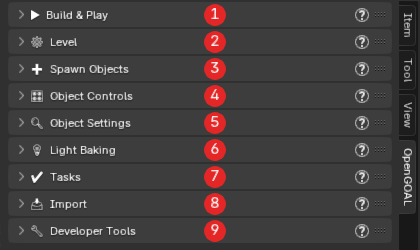

[↑ OpenGOAL Level Tools — User Guide](README.md)

# Importing

The **Import** tab (⑧ in the [sidebar screenshot](images/sidebar.png)) brings things from the game, or from
other levels, into your .blend. It has three sub-panels:

- **Game 3D Models**: the game's own models and level meshes (GLB files made by the OpenGOAL decompiler), as reference.
- **Game Textures**: browse the game's textures and put them on your meshes.
- **From GOAL Files**: read a level's definition files (a custom level's .jsonc, the game's entity files, level-info.gc ...)
  and rebuild its actors, cameras, checkpoints, nav-meshes and more as add-on objects.

All three read from the decompiler output folder (`decompiler_out/jak1/`). The add-on finds it from your OpenGOAL
paths: **Preferences › Decompiler output (override)**, or this .blend's **Decompiler output** in
**Developer Tools › Paths › Project Folders** (see [Developer Tools](developer-tools.md)). When neither is set it uses
`<data folder>/decompiler_out/jak1`.

---

## Game 3D Models

**Import › Game 3D Models** lists every `.glb` file under `decompiler_out/jak1/` (all subfolders, e.g.
`levels/village1/village1-background.glb` or `levels/beach/babak-lod0.glb`). A model the decompiler wrote in
several levels' folders (like `babak-lod0`) is listed once.

### First time: Find Models

If the add-on hasn't found any GLB yet, the panel shows **Setup needed**:

1. Click **Find Models** and pick your `decompiler_out/jak1/` folder. It is usually
   `<opengoal>/active/jak1/data/decompiler_out/jak1/`.
2. The folder is saved as the add-on preference **Decompiler output (override)** and scanned straight away.
3. If nothing was found, the panel shows **No GLBs found. Set the path manually:** with a **Decompiler path** field,
   **Re-pick** (open the folder picker again) and **Rescan**.

No GLB files at all means the decompiler was run without its level export. Turn it on and run the decompiler again:
- **OpenGOAL launcher**: **Settings › Decompiler**, turn on **Rip levels**, then run the decompiler.
- **By hand**: set `rip_levels` to `true` in the decompiler's config file and run it.
- **Dev build (jak-project clone)**: run `task rip-levels`; no config file to edit. (`Taskfile.yml` in the clone lists
  every task, some others can be handy too.)

### Searching and importing

1. Type part of a name in the search box (for example `babak` or `village1`). Only the file name is matched, not the folder.
2. The line under it shows how many files match. At most 25 are listed: **25 of N matches (refine search)** means
   type more.
3. Click a name to import it.

Each import goes into its own collection, **Imports › &lt;file name&gt;**, at the top of the scene, outside every level.
Nothing in **Imports** is ever exported, so you can keep reference models in your .blend safely. Importing the same
file again adds another copy to the same collection.

| Control | What it does |
|---|---|
| Search box | Filters the list as you type (part of the file name, any case). Empty shows everything. |
| Eye button | Hides / shows the result list (keeps your search). |
| Refresh button (**Rescan GLBs**) | Scans the folder again, e.g. after running the decompiler again. |
| A file name | Imports that GLB into **Imports › &lt;name&gt;**. |
| **Find Models** / **Re-pick** | Pick the `decompiler_out/jak1/` folder (setup only). |
| **Decompiler path** | The folder, typed in by hand (setup only, when nothing was found). |

Tips:
- Actor models (`*-lod0.glb`) are handy to check sizes. Actors you spawn already show their own model as a preview
  (Preferences › **Preview Models**), so you don't need to import those by hand.
- Whole vanilla levels (`*-background.glb`) are useful to copy a layout, check scale or place your custom level in relation with them.

---

## Game Textures

**Import › Game Textures** shows the PNG textures the decompiler saved under `decompiler_out/jak1/textures/`, one
folder per texture page (tpage).

If the panel says **Textures not found.** the decompiler didn't save them: run it with `save_texture_pngs: true`
in its config, then extract again.

### How to texture a mesh

1. Pick a group in the drop-down (for example **Jungle**) and click **Load**.
2. Optional: type in the search box to filter by texture name.
3. Browse the pages with the arrow buttons (20 textures a page) and click a texture to select it. The box under the
   grid shows its name and **Source:** (the tpage it comes from).
4. Select your mesh(es) and click **Apply to Selected**. In Edit Mode, select faces and click
   **Apply to Selected Faces** instead.

The texture becomes a material named `og_<texture name>` (an Image Texture into a Principled BSDF). The same material
is reused every time you apply that texture.

- **Apply to Selected** (Object Mode) puts the material in the **first** material slot of every selected mesh
  (replacing what was there).
- **Apply to Selected Faces** (Edit Mode) adds the material to the active mesh (if it isn't there yet) and assigns it
  to the selected faces only, so one mesh can have many textures.

| Control | What it does |
|---|---|
| Group drop-down | Which textures to load: **All**, **Common**, **Effects**, **Characters**, one entry per game area (**Beach**, **Jungle**, **Swamp**, **Misty**, **Snow**, **Fire Canyon**, **Lava Tube**, **Ogre**, **Sunken**, **Rolling**, **Cave**, **Village**, **Training**, **Citadel**, **Final Boss**) and **HUD / UI**. |
| **Load** | Loads the group's textures into the browser (needed after changing the group). |
| Search box | Filters the loaded textures by name. |
| ◀ / ▶ | Previous / next page. |
| A texture | Selects it. |
| **Apply to Selected** / **Apply to Selected Faces** | Puts the selected texture on the selected meshes / faces. Greyed out until a mesh is selected. |

How textures end up in the game, and how many a level can have, is on the [Geometry](geometry.md) page.

---

## From GOAL Files

**Import › From GOAL Files** reads level definitions and turns them back into add-on objects in the **active level**:
actors with their settings filled in, their paths and volumes, ambients, cameras, checkpoints, load boundaries and
nav-meshes. Use it to:

- bring parts of another custom level (its `.jsonc`) into this one,
- copy objects between .blend files (with **Object Controls › Export Selected Definitions** ([Object Controls](object-controls.md#export-selected-definitions)), which also copies them
  to the clipboard),
- rebuild a vanilla level's actors from the game's own files to study or reuse them.

### What it can read

| File | Where | What you get |
|---|---|---|
| A custom level's `.jsonc` | `custom_assets/jak1/levels/<level>/<level>.jsonc` | Actors, ambients, built-in cameras, checkpoint triggers |
| The game's entity files (`.json`) | `decompiler_out/jak1/entities/` (one file of actors, one of ambients per level) | Actors, ambients |
| `entity.gc` or `<level>-nav.gc` | `goal_src/jak1/...` | Nav-meshes |
| `level-info.gc` | `goal_src/jak1/engine/level/` | Checkpoints (continue points) |
| `load-boundary-data.gc` | `goal_src/jak1/engine/level/` | Load boundaries |
| Copied text | the clipboard | Any of the above: a whole file or just a part of one (a few entries copied out of a list are fine) |

In a release install these are under the `data` folder (for example `data/goal_src/jak1/engine/level/level-info.gc`; `entity.gc` is in `data/goal_src/jak1/engine/entity/`).

### How to import

1. Make sure the level you want the objects in is the active level (**Level** tab). **Import** stays greyed out
   without one.
2. Pick a file in the file field and click **Load**, or copy text and click **Paste from Clipboard**.
3. Repeat for more files: each one **adds** to the list (loading the same file again replaces its entries). Load
   files that belong together one after the other, for example a level's actor and ambient files, its `entity.gc`
   and `level-info.gc`.
4. The list is grouped by category: **Actors**, **Ambients**, **Cameras**, **Nav-meshes**, **Checkpoints**,
   **Load boundaries**. Each header shows *picked / total*. Open a category to tick or untick single entries, or to
   filter it by name.
5. Click **Import N picked**. The new objects are selected when it's done, and the status bar says how many were made
   and what was skipped.

| Control | What it does |
|---|---|
| File field + **Load** | Reads a file and lists what it defines. |
| **Paste from Clipboard** | Lists the definitions in the copied text. |
| **Select All** / **Deselect All** | Picks / unpicks everything in the list. |
| Bin button (**Clear**) | Empties the list. |
| Tick boxes in a category header | Pick / unpick every entry of that category. |
| Tick box on a row | Import this one or not. The grey text after the name is its type or source. |
| **Import N picked** | Imports the picked entries into the active level. |

The list only lives while Blender is open (it isn't saved in the .blend).

### What happens to each kind

**Actors.** Each becomes a normal actor (`ACTOR_<etype>_<name>`) at the same place and rotation, as if you had
spawned it. Its lumps are read back into the actor's settings, so you can edit them in **Object Settings**:

- known settings fill their fields (task, crate contents, options, enums, distances ...),
- a `path` (and `pathb` ...) becomes a curve linked as the actor's path, with its smooth / knot setup,
- a `vol` (for actors that use a volume) becomes a `VOL_` mesh linked to the actor,
- scale is set on the empty when the actor reads scale,
- links to other actors (`alt-actor`, `next-actor` ...) are set when the target is imported too or is already in the
  scene,
- everything else becomes a **Custom Lumps** row, so a re-export writes the same lumps.

Actor types the add-on doesn't know are marked **(custom actor)** in the list; they import with all their lumps as
custom lumps. A `<level>-<etype>` or `lt-<etype>` name (an [edited actor](edited-actors-and-goal-code.md)) is
turned back into its normal actor.

**Ambients.** Sound emitters, music zones and hints are supported (`AMBIENT_snd...`, `AMBIENT_mus...`,
`AMBIENT_hint...`). Other ambient types are listed as **(no addon object for it)** and are not picked. A custom
level's hint text lives in its text file, not in the .jsonc, so imported hints of a custom level show a note to
retype the text.

**Cameras.** A custom level's built-in cameras become `CAMERA_` objects with their mode, settings, flags, look-at /
align / pivot empties, path and volumes. Entries `<name>`, `<name>-1` ... that only differ in their volume become one
camera with several volumes. Camera lumps without a matching setting are left out (they're listed in the system
console).

**Checkpoints.** Continue points from `level-info.gc` become `CHECKPOINT_` empties with their resident levels,
display modes, flags, vis nickname and load commands. A respawn camera that isn't the default becomes a `_CAM` child
empty. The checkpoint *triggers* in a level's .jsonc (`lt-checkpoint` actors) are listed as **&lt;name&gt; trigger**: they
turn on the trigger of their checkpoint (sphere radius or a `VOL_` volume). Import the checkpoint first, or in the
same go.

**Load boundaries.** Each `static-load-boundary` becomes a `LOADBND_` mesh with its points, height, flags and its
forward / backward commands. A custom level's block (the part the add-on wrote) is named after that level.

**Nav-meshes.** Each nav-mesh becomes a mesh with its jump faces marked by the nav materials, linked to the actors
that use it:

- from `entity.gc`: the actor with that actor id. Load and import the actors first (or have them in the scene),
  otherwise it imports with **no actor found to link it to**.
- from a `<level>-nav.gc` (custom-nav): every imported actor with a matching `custom-nav` lump.

Nav-spheres stored on the actors become nav-sphere empties. See [Enemies & nav-meshes](enemies-and-navmesh.md).

### What can't be imported

- Level geometry and collision (use **Game 3D Models** for the vanilla meshes; a custom level's mesh is its own `.glb`).
- Level settings (name, mood, sky, music, sound banks ...), tasks and their texts, GOAL code.
- Ambient types other than sound, music and hint.
- Anything a file doesn't hold: a game entity file has no nav-meshes, `level-info.gc` has no actors, and so on.

### Tips

- To copy objects between .blend files: select them, **Object Controls › Export Selected Definitions**, then in the
  other file **Paste from Clipboard** and **Import**.
- Importing the game's `load-boundary-data.gc` shows where the vanilla load boundaries are, handy to check that your
  level doesn't sit on one (see [Troubleshooting](troubleshooting.md)).

---

[← Previous](edited-actors-and-goal-code.md) · [Guide index](README.md) · [Next →](developer-tools.md)
