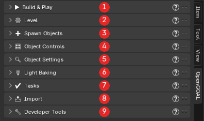
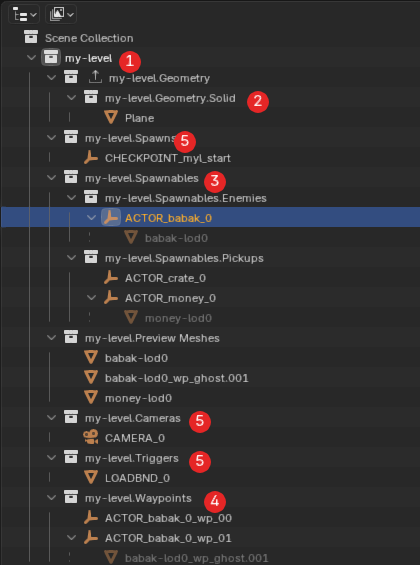

[↑ OpenGOAL Level Tools — User Guide](README.md)

# The interface

Everything the add-on adds lives on the **OpenGOAL** tab of the 3D viewport's sidebar (press **N** in the viewport). This page is a map: what each panel is for, how a level is laid out in the Outliner, how objects are named, and what the warning numbers mean.

## The sidebar panels

The panels are listed top to bottom; the numbers match the sidebar screenshot.

| | Panel | What it's for | Details |
|---|---|---|---|
| ① | **Build & Play** | Export the level, compile it with GOALC and launch the game at a checkpoint. Shows the level's warning count. | [Build & Play](build-and-play.md) |
| ② | **Level** | Pick the active level at the top. Sub-panels: **Level Manager** (**Add Level**, **Assign Existing**), **Settings** (name, sound and music, visuals, gameplay, project settings), **Collections** and **Level Audit**. | [Levels](levels.md) |
| ③ | **Spawn Objects** | One searchable list of everything you can place: actors, checkpoints, cameras, volumes, sounds and more, sorted into category tiles. New objects go to the 3D cursor. | [Actors](actors.md) |
| ④ | **Object Controls** | Works on the whole selection: **Frame**, **Duplicate**, **Delete**, a summary of what's selected, tools to affect the selection such as **Set to Floor**, **Convert Entities** and the **Vertex Colors** tools. | [Object Controls](object-controls.md), [Lighting](lighting.md#vertex-colors-tools) |
| ⑤ | **Object Settings** | The settings of the active object. For an actor: **Actor Settings** (with sub-panels such as **Path**, **Entity Links**, **Crate**…), **Custom Lumps** and **GOAL Code**. Other objects (checkpoints, cameras, volumes, meshes) show their own settings. | [Actors](actors.md) |
| ⑥ | **Light Baking** | Bake Cycles lighting into the meshes' vertex colours, with bake options, time of day and colour quantisation. | [Lighting](lighting.md) |
| ⑦ | **Tasks** | Your own power cells and scout flies, and their texts. Needs mod-base. | [Tasks](tasks.md) |
| ⑧ | **Import** | **Game 3D Models**, **Game Textures** and **From GOAL Files** (read an existing level's `.jsonc`). | [Importing](importing.md) |
| ⑨ | **Developer Tools** | **Clean Files**, **Paths**, **Addon Settings** (launch timing, build settings, versions, importing settings from another .blend), **Warning Settings** and **Quick Open** for the generated files. | [Developer Tools](developer-tools.md) |

Most panels start closed. Click a panel's header to open it. The **?** on the right of the main panels' headers (and
of larger features such as **Path**, **NavMesh**, **Camera Settings** or **GOAL Code**) opens that part of this guide in
your browser.

## How a level is laid out

A level is a top-level collection in the Outliner (① in the Outliner screenshot), named after the level. The add-on makes the collections inside it for you, as you add things. Their names start with the level name, so two levels in one file don't clash: `my-level.Geometry`, `my-level.Spawnables.Enemies` and so on.

| Collection | What goes in it |
|---|---|
| **Geometry** ② | The level's 3D model: every mesh in here and in its sub-collections is exported as the level's `.glb`. The add-on puts loose meshes in **Geometry › Solid**. |
| **Spawnables** ③ | Actors, sorted by type: **Enemies** (bosses too), **Platforms**, **Props & Objects**, **NPCs**, **Pickups**. |
| **Waypoints** ④ | The waypoint empties of actors' paths, and launchers' destinations (`DEST_`). |
| **Paths** | Curves used as paths. |
| **Spawns** ⑤ | Checkpoints and their spawn cameras. |
| **Cameras** ⑤ | `CAMERA_` cameras and their helper empties (anchor, pivot, look-at target). |
| **Triggers** ⑤ | `VOL_` trigger volumes and load boundaries. |
| **Water Volumes** | Water volumes. |
| **Sound Emitters** | Sound emitters, music zones and hints. |
| **NavMeshes** | Nav-meshes for enemies. |
| **Export As** | Meshes exported as actors (one actor per vertex). |
| **Preview Meshes** | The game models shown on actors in the viewport. Never exported. |

You can make your own collections too, for example to organise geometry. Some rules:

- Only meshes inside **Geometry** become level geometry. Meshes elsewhere aren't exported; **Build & Play** warns about them and offers **Move to Geometry**.
- A collection with its **skip_export** custom property turned on is left out of the export, with everything in it. The add-on has a UI for this in **Level › Collections › Disable Export**.
- **Level › Collections › Sort & Clean** moves loose objects into the right collections by their name.

More: [Levels](levels.md) and [Geometry](geometry.md).

## Object names

The add-on recognises objects by their names, so keep the prefix (and for actors the type) when you rename something. The game's own names (the "etype") are used, so an orb is `money`, not "orb".

| Name | What it is | Example |
|---|---|---|
| `ACTOR_<etype>_<n>` | An actor (an empty). `<etype>` is the actor's type; `<n>` is a number, or a name you choose. | `ACTOR_babak_0`, `ACTOR_money_3` |
| `<actor>_wp_<nn>` | A waypoint of the actor's path. Extra paths: `<actor>_wp_<path name>_<nn>`. Older files may also have `_wpb_`. | `ACTOR_plat_0_wp_00` |
| `CHECKPOINT_<nick>_<name>` | A checkpoint (continue point). `<nick>` is the level's vis nickname; the first checkpoint is `start`, then `cp1`, `cp2`… In the game it's called `<level>-<name>`. | `CHECKPOINT_myl_start` |
| `<checkpoint>_CAM` | The camera used when spawning at that checkpoint. | `CHECKPOINT_myl_start_CAM` |
| `CAMERA_<n>` | A camera. Helper empties: `CAMERA_<n>_ALIGN`, `_PIVOT`, `_LOOKAT`. | `CAMERA_0` |
| `VOL_…` | A trigger volume (a mesh). Renamed after what it's linked to: `VOL_<id>`, `VOL_<target>` or `VOL_<id>_<n>links`. | `VOL_CAMERA_0` |
| `LOADBND_<n>` | A load boundary. | `LOADBND_0` |
| `AMBIENT_snd<nnn>` | A sound emitter. | `AMBIENT_snd001` |
| `AMBIENT_mus<nnn>` | A music zone. | `AMBIENT_mus001` |
| `AMBIENT_hint<nnn>` | A hint. | `AMBIENT_hint000` |
| `NAVMESH_…` | A nav-mesh. | |
| `DEST_<…>` | A launcher's destination. | |

Every object type and its options are explained on the feature pages, for example [Level flow](level-flow.md), [Cameras](cameras.md) and [Volumes & triggers](volumes-and-triggers.md).

## Warnings: the ⚠ counts and Level Audit

The add-on checks your level as you work. The results are only recomputed after an edit, so they don't slow Blender down.

- **Red ⚠ count**: something is required but missing, for example an actor that must have a path or a link slot that must point to another actor. These can break the build or crash the game. Fix them first.
- **Grey ⚠ count**: a soft warning. It works, but does less than you probably want, for example a sound whose sound bank the level doesn't load so it'll be missing.

Warning types you don't care about can be turned off for the .blend in
[Developer Tools › Warning Settings](developer-tools.md#warning-settings).

The counts show next to **Export & Compile** for the whole level (⑤ in the Build & Play screenshot), and in an actor's **Object Settings** panels for that actor. Hover over a count to see what's missing; click it to see the list.

**Level › Level Audit** is a fuller check of the whole level. Click **Run Audit**: it lists errors, warnings and info, each with a button that selects and frames the object it's about. The panel header shows the number of errors (E) and warnings (W) from the last run.

Every warning and how to fix it: [Troubleshooting](troubleshooting.md).

---
[← Previous](first-level.md) · [Guide index](README.md) · [Next →](build-and-play.md)
