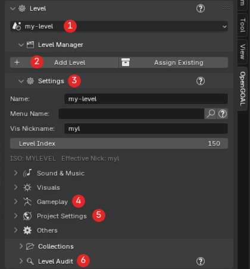

# Levels

A level is a Blender collection marked as a level. One .blend can hold several levels, and each one becomes its own
level in the game. The **Level** tab (② in the [sidebar](images/sidebar.png)) is where you make levels, pick the one
you are working on, and set it up.

## Make a level

1. Open **OpenGOAL › Level**. In a new file it says *No levels in this file*.
2. Click **Add Level** (② in the Level screenshot). A dialog opens:
   - **Level Name**: lowercase with dashes, 10 characters at most (`my-level`).
   - **Base Actor ID**, **Level Index**, **Vis Nickname**: filled in for you with free values. You can leave them as they are.
   - **Texture Remap / Sky**: the vanilla level whose texture remap and sky your level borrows. You can change both later.
3. Click **OK**. The add-on makes the collection, a **Geometry** collection inside it, and makes it the active level.

Already have a collection with your level in it? Click **Assign Existing** instead and pick it in the **Collection**
field. The dialog has the same fields as Add Level.

The dialog refuses a name that is empty, longer than 10 characters or already used by another level of the file, a
**Level Index** another level uses, and a **Vis Nickname** longer than 3 letters or already used.

## Several levels in one .blend

- The drop-down at the top of the **Level** tab (① in the Level screenshot) picks the **active level**. Almost
  everything in the sidebar works on the active level: new objects go into its collections, the settings below are
  its settings, **Export & Compile** builds it. Switching also makes it Blender's active collection.
- **Build & Play › All levels** exports every level of the file and compiles once (see [Build & Play](build-and-play.md)).
- Each level needs its own name, **Level Index** and vis nickname. The add-on picks free ones for new levels and
  shows a red warning in **Settings** if two levels clash.
- Each level has its own checkpoints (named `CHECKPOINT_<nick>_start` so two levels can both have a "start").
- Levels next to each other can load each other with load boundaries: see
  [Volumes & triggers](volumes-and-triggers.md#load-boundaries).

### Renaming a level

Change **Level › Settings › Name**. The collection and its sub-collections are renamed with it, and custom tasks that
belong to the level follow.

The game files written under the old name are still on disk. A box under the name says
*Old files of '...' are removed on the next export*: the next export deletes the old name's .jsonc, .glb, .gd and
-obs.gc files and its game.gp / level-info.gc / load boundary entries, and changes this .blend's references to the
old name (load commands, custom level fields, checkpoint names) to the new one. **Clean Now** does it right away.
This is the **Clean renamed levels** option in **Developer Tools › Addon Settings › Build Settings** (on by
default). With it off, the old files stay and the box turns red.

If the new name already has level files that this .blend didn't write (another .blend's level?), a red line warns
that exporting overwrites them.

### Removing a level

Delete the collection in the Outliner. Its game files stay on disk and in the game's build files. To remove them,
open **Developer Tools › Addon Settings › Build Settings › Leftover levels**: it lists the levels in game.gp that no
level of this .blend has, each with an **X** button. Levels of your other .blend files show there too, so only
remove the ones you are sure about.

**Developer Tools › Clean Files** deletes the active level's generated files (it lists them and asks first) so the
next build writes them fresh. See [Developer Tools](developer-tools.md).

## Settings

**Level › Settings** (③ in the Level screenshot) holds everything about the active level. It is split into closed
sections: **Sound & Music**, **Visuals**, **Gameplay**, **Project Settings** and **Others**. All of it is saved on
the level collection.

At the top:

| Field | What it does |
|---|---|
| **Name** | The level's name in the game files. Lowercase, dashes for spaces, 10 characters at most (longer names are cut, with a red warning). |
| **Menu Name** | The level's name in the game's menus, used for its custom tasks. Blank: the level name. The search button picks an existing game text. See [Tasks](tasks.md). <!-- check: menu name only used by tasks export --> |
| **Vis Nickname** | The 3-letter nickname used for the level's DGO / vis files. Blank: the first 3 letters of the name (without dashes). Must be different for every level. |
| **Level Index** | The level's number in the game's level list. Must not clash with vanilla levels or other custom levels: use 100 or more. |

The grey line under them shows the **ISO** name (the DGO file name: the name without dashes, in capitals, 8
letters) and the **Effective Nick**.

### Sound & Music

**Music Bank**, **Sound Bank 1** and **Sound Bank 2**. See [Audio](audio.md).

### Visuals

| Field | What it does |
|---|---|
| **Mood** | The vanilla mood the level uses: its fog, light and sun tables. **Custom** lets you type one. Some moods use a fixed time of day; the Light Baking tab warns about them (see [Lighting](lighting.md)). |
| **Mood Function** | The update-mood function run every frame. **Same as mood** (default), a vanilla one, or **Custom**. |
| **Ocean** | The ocean drawn with the level: **None** (default), **Village 1**, **Village 2**, **Sunken** or **Custom**. |
| **Sun Fade** | How much of the sun is drawn (0 to 1). |
| **Sky** | The vanilla level whose sky is drawn. **None (no sky)** for caves and interiors. **Custom**: type a level name. |
| **Texture Remap** | The vanilla level whose texture remap table and texture pages the level uses. Things drawn with the game's generic textures need it: Flut Flut eyes, water, dark eco pools, dying enemies. Use **None** for a level loaded at the same time as another custom level (two loaded levels sharing one crash). See [Geometry](geometry.md#textures). |
| **Override Mood Fog** | Your own fog instead of the mood's: **Fog Color**, **Fog Start (m)**, **Fog End (m)**, **Fog Max**, **Fog Min**. Adds a small fog-control actor to the level. Turn it off to go back to the mood's fog. |

### Gameplay

④ in the Level screenshot.

| Field | What it does |
|---|---|
| **Death Plane (m)** | Below this height Jak dies from an endless fall. Default -20 m. |
| **Orb Count** | The orbs shown on the level's progress page. Blank: counted from the actors (orbs, crates, orb caches, enemy drops, the pipe game, the plant boss ...). The button next to it counts them now and shows **Auto: N**. Type a whole number to use it instead. |
| **Automatic Wall Angle** | Faces steeper than this are walls Jak can't stand on. Default 45°, -1 turns it off. |
| **Double Sided Collision** | Collide with both sides of every face. Doubles the collision mesh. |
| **Checkpoints (N)** | The level's checkpoints; click one to select it, **+** adds one. A red line warns when there is no "start" checkpoint. See [Checkpoints & cameras](checkpoints-and-cameras.md). |
| **Tasks (N)** | The game tasks of this level. Custom tasks set to this level are listed in grey; **+** adds a vanilla or custom task. See [Tasks](tasks.md). |

### Others

| Field | What it does |
|---|---|
| **Bounding Sphere** | An empty (sphere) whose position and size are the level's bounding sphere. The game uses it to find the level you are nearest to, which blends the mood and sky between levels. Empty: computed from the checkpoints. |
| **Base Actor ID** | The first actor ID of the level. Must be different for every custom level (to avoid "ghost" actors). New levels get the highest one + 1000. |
| **Level nick in actor names** | Exported actor names start with the vis nickname (`<nick>-babak-0`) so they can't clash with vanilla actors or other loaded levels. On by default. |
| **Commands** | **Load Commands** and **Alt Load Commands**: commands run when the level loads, one per row without the brackets (`special "med-res-level-1" #t`). **Priority**: which of two loaded levels is the main one (lower wins; vanilla 100). **Wait For Load**: show the level only when it is fully loaded. |
| **Always Include** | Adds the content of a text (Text Editor) to the level on every export, for things no actor in the .blend brings. See below. |

#### Always Include

Tick **Always Include**, then pick a text or make one with **+**. The other buttons open it in the Text Editor and
fill it with the template (**Insert Template**; it asks before replacing). The template is JSONC (comments allowed)
with these keys, all optional:

| Key | Added to |
|---|---|
| `gd` | the level's .gd / DGO (`"my-code.o"`, `"thing-ag.go"`) |
| `json_ag` | the .jsonc art groups |
| `json_texture` | the .jsonc textures (a texture page, or `[page, texture, ...]`) |
| `goal_src` | game.gp lines for your own code (`["levels/my-level/my-code.gc", "process-drawable"]`) |
| `actors`, `ambients`, `cameras` | copied as they are into the .jsonc (game coordinates) |

Under the picker the panel shows a summary of what the text adds, or its errors. For your own GOAL code see
[Edited actors & GOAL code](edited-actors-and-goal-code.md).

## Project Settings

**Level › Settings › Project Settings** (⑤ in the Level screenshot) is for the whole .blend, not the active level.
The export writes these values into the game's own files. A blank field leaves the game as it is (and puts back the
vanilla value if you had set one before).

| Field | What it does | Blank (vanilla) |
|---|---|---|
| **Retail Boot Checkpoint** | Where a retail (non-debug) boot starts | `title-start` the title screen |
| **New Game Checkpoint** | Where **New Game** starts | `intro-start` the intro, then Geyser Rock |
| **Quit To Menu Checkpoint** | Where **Quit** in the pause menu goes | `title-start` the title screen |
| **Discord RPC Status** | The text Discord shows while playing your mod | "Playing Jak and Daxter: The Precursor Legacy™" |

The checkpoint fields suggest this .blend's checkpoints (`<level>-<name>`) and the game's. The boot modes of Build &
Play are explained in [Build & Play](build-and-play.md).

## Collections

**Level › Collections** has one button, **Sort & Clean**: it moves every object of the level into the sub-collection
it belongs in (meshes to Geometry › Solid, `VOL_` meshes to Triggers, actors to Spawnables by category, checkpoints
to Spawns, waypoints to Waypoints, sound emitters to Sound Emitters, cameras to Cameras, path curves to Paths,
nav-meshes to NavMeshes). Then it removes orphan previews, empty collections and unused data. Objects it can't place
stay where they are and are listed in a warning. The collections are described in [The interface](interface.md).

### Disable Export

**Level › Collections › Disable Export** lists the level's sub-collections as a tree. Tick one to leave it (and
everything in it) out of the export. It sets the collection's `skip_export` custom property, which you can also
change in **Properties › Collection › Custom Properties**. Handy for test objects and work in progress.

## Level Audit

**Level › Level Audit** (⑥ in the Level screenshot): click **Run Audit** to check the active level. Each result has
a severity (error, warning, info), a message and, when it is about one object, a button that selects and frames it.
The header shows the counts. It checks things like a missing "start" checkpoint, broken links and volumes without
links, missing nav-meshes or paths, sound banks, texture remaps, meshes outside Geometry and load boundaries, and
ends with a summary of the scene. The ⚠ counts next to **Export & Compile** and on the actor panels are updated on
their own; see [Troubleshooting](troubleshooting.md) for what each warning means.

## Export Filter

**Developer Tools › Addon Settings › Build Settings › Export Filter** leaves parts of the export out, for testing
or special setups. Tick **Filter exports**, then untick the parts to skip: the level folder files (**Geometry
(GLB)**, **Entities (.jsonc)**, **Load (.gd)**, **Actor code (-obs.gc)**), **game.gp definition**, **Nav-mesh
(entity.gc)**, **Task & Menu**, level-info (**Level settings**, **Checkpoints**), **Load Boundaries** and **Project
settings** (unticked: the game files of Project Settings aren't touched at all). Skipping parts can break the compile
or crash the game.

---
[← Previous](build-and-play.md) · [Guide index](README.md) · [Next →](geometry.md)
