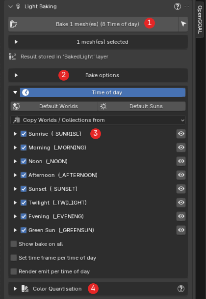

# Lighting

Jak 1 doesn't light level geometry while you play. The light is **baked** into the meshes' vertex colours in
Blender, and the game just draws those colours. This page shows how to bake that light, give your level a full
day / night cycle, check how the colours will look in game, fine-tune them by hand, and light actors with the
**Actor Light**.

**Contents**
- [How Jak 1 lighting works](#how-jak-1-lighting-works)
- [Light Baking](#light-baking)
- [Bake options](#bake-options)
- [Time of day](#time-of-day)
- [Color Quantisation](#color-quantisation)
- [Smaller level files](#smaller-level-files)
- [Vertex Colors tools](#vertex-colors-tools)
- [Actor Light](#actor-light)

## How Jak 1 lighting works

- **Level geometry** is lit by its **vertex colours**. You light the scene in Blender with normal lights and a
  world, and Cycles bakes the result into a colour layer on each mesh. Whatever the layer shows in the viewport
  is roughly what you get in game.
- **Time of day.** A level can carry up to **8 colour layers**, one per time of day: `_SUNRISE`, `_MORNING`,
  `_NOON`, `_AFTERNOON`, `_SUNSET`, `_TWILIGHT`, `_EVENING`, `_GREENSUN`. The game blends between them as its
  clock moves. A level without them uses one layer for every time (the add-on bakes it as `BakedLight`). If a
  mesh is missing a time, the level builder uses the closest time it has.
- **Mood.** Actors (Jak, enemies, crates ...), the fog and the sun are lit by the level's **mood**, picked in
  **Level › Settings › Visuals** (see [Levels](levels.md)). Some moods (caves, the citadel ...) use a fixed time,
  so time of day never changes in them.
- **The palette.** When the level is built, all its vertex colours (every mesh, every time of day) are squeezed
  into one palette of at most **8192 colours**. Rare colours, like dark tinted shadows, can come out different
  from your bake. [Color Quantisation](#color-quantisation) shows you the result in Blender before you build.

## Light Baking

The **Light Baking** tab (⑥ in the [sidebar](images/sidebar.png)) bakes Cycles lighting into vertex colours.
Baking needs an active level (see [Levels](levels.md)); the settings are saved per level.

**To bake:**
1. Set up your lights (and a world) in the scene. Emissive materials can light the level too (see **Emit
   strength** below).
2. Select the meshes to bake. The arrow button next to **Bake** selects every mesh of the level's geometry for
   you (hidden and unselectable meshes are skipped). Lights, empties and empty meshes in the selection are skipped
   on their own.
3. Set the **Sample Count** and the other [Bake options](#bake-options).
4. Click **Bake N mesh(es)** (① in the Light Baking screenshot). With [Time of day](#time-of-day) on, the button
   also shows how many times will bake.

The result goes into the `BakedLight` colour layer (or the time of day layers), which becomes the shown and
exported layer. Blender stays usable while it bakes: each pass is a normal Blender bake job.

**While it bakes**, a status line under the Bake button shows the current pass ("Baking: Noon pass (12 mesh(es))
— 3 of 9"), then the post-processing. At the end it shows the result and how long it took, e.g. "Baked 12
mesh(es), 8 time(s) of day in 04:31 (combined): Sunrise, Morning, …, emit, curve". Errors show in red, starting
with "Bake error".

Under the button the panel lists the selected meshes (click the header to open the list). A light icon marks
meshes with an emissive material.

> Baking sets the scene's render engine to Cycles and its samples to the Sample Count. It doesn't switch them
> back afterwards.

## Bake options

Open **Bake options** (② in the Light Baking screenshot). They apply to the next bake; existing bakes don't change.

| Option | Default | What it does |
|---|---|---|
| **Sample Count** | 128 | Cycles samples per bake. More = less noise, slower. |
| **Combine meshes while baking** | off | Much faster on big scenes. Blender normally re-prepares the whole scene for every mesh, so 40 meshes cost about 40 renders. With this on the selected meshes are baked as one temporary copy, and the colours go back into each mesh. Your objects aren't changed. |
| **Face Corner** / **Vertex** | Face Corner | Where the colours are stored. Face Corner keeps clean edges where the model is sharp; Vertex is smoother, with no hard edges. |
| **Color Depth** 8 / 6 / 5 / 4 bit | 8 bit | Levels per colour channel in the exported level file (the bake itself isn't changed). Lower values make the file smaller (see [Smaller level files](#smaller-level-files)) but can show **banding**: a red warning shows how many colours remain, e.g. "32 colours per channel (32,768 in all) in the GLB: may show banding". Color Quantisation's preview uses it too. |
| **Auto save before bake** | off | Saves the .blend before the bake changes anything (baking very large files can crash Blender). The .blend must have been saved once, or the bake doesn't start. |
| **Emit strength** | 1.0 | How much emissive materials brighten the bake. Meshes with an emissive material get an extra Emit pass, blended on top so it can only brighten. 0 = no emit pass. |
| **Light curve** | off | Remaps the baked light with a curve, see below. |
| **Auto blur** | off | Smooths the bake by averaging neighbouring colours, see below. |
| **Ignore vertex colours in materials** | on | While baking light, the materials' Color Attribute nodes are unplugged. They read colour layers: a black layer would bake black, alpha 0 makes the surface see-through (also black). Turn off if your vertex colours or transparency should affect the bake. |
| **Apply effects** | off | After the bake, each mesh's [Effects After Bake](#effects-after-bake) run in order. |
| **Automatically copy lighting to** | off | Last step of every bake: the meshes of the chosen collection (rendered or not, sub-collections too) get the lighting of the level's other geometry, like [Copy Vertex Lighting from Closest](#copy-vertex-lighting-from-closest). Handy for grass and plants. Its **Search** and **Max distance** are the same settings as that tool's. |

**Alpha.** The bake itself writes alpha 1.0. If a mesh has a colour layer called `ALPHA` (or `ALPHA_SUNRISE`,
`ALPHA_NOON` ... per time of day), its alpha is copied into the baked layers as the last step.

**Light curve.** Jak 1 shows values below about 0.25 as black and values above 0.75 as over-lit. The curve lets
you fit the bake into that range.
- Pick a **Preset**: **Fit 0.25-0.75** (lifts darks, eases highlights), **Fit 0.25-1.0** (lifts darks, brights up
  to 1.0), **Soft** (slightly flatter), **Contrast** (darker darks, brighter brights), **Linear** (no change) or
  **Custom**. Choosing a preset overwrites the curve.
- The first time, click **Set Up Curve** to create the level's curve, then edit it in the curve widget.
- **+** saves the current curve as your own preset (kept in this .blend). With your preset picked, the refresh
  button updates it and **−** removes it.
- **Factor** (0-1) sets how much the curve affects the result.

**Auto blur** options: **Strength** (0-1, default 0.5) and **Passes** (1-50, default 2). With Face Corner bakes
you also get **Keep sharp edges** (on: no mixing across edges marked sharp or flat-shaded faces) and **Auto
sharp** with an **Angle** (default 30°): edges sharper than the angle count as sharp too.

The order of post-processing is: emit, light curve, blur, [palette fixes](#color-quantisation) (if **Apply after
every bake** is on), alpha, then Effects After Bake and the automatic lighting copy.

## Time of day

Tick **Time of day** in its box (③ in the Light Baking screenshot) to bake one colour layer per time of day, each
with its own lights and world. Off, the bake makes one `BakedLight` layer.

Time of day needs an OpenGOAL version whose level builder reads those layers (0.3.8 or newer). On an older
install a warning line shows under the checkbox (see [Developer Tools](developer-tools.md) for your versions).

If the level's mood uses a fixed time, a red warning says so: "Mood 'maincave' uses a fixed time: time of day
won't change in game" (jungleb, maincave, darkcave, robocave, lavatube, citadel), or "switches to a fixed time in
places" (ogre, finalboss).

**Quick start:**
1. Tick **Time of day**.
2. Click **Default Worlds** (a world for every time that has none) and **Default Suns** (a sun per time, with an
   angle and colour for an outdoor look like Sandover's; each lands in a new light collection if the time has none).
3. Select the level's meshes and **Bake**. Each time is a separate pass, so this takes about 8 times as long:
   **Combine meshes while baking** helps a lot.
4. Use the eye buttons to look at each time.

**Per time of day** (Sunrise, Morning, Noon, Afternoon, Sunset, Twilight, Evening, Green Sun):

| Control | What it does |
|---|---|
| Checkbox **Sunrise (_SUNRISE)** ... | Bake this time. Unticked times are skipped (the game then uses the closest baked time). |
| Eye button | Shows this time's layer on the selected meshes (makes it their active and render colour layer). |
| **Lights** | The light collection used only for this time. While a time bakes, the other times' collections are off. Lights outside all these collections light every time. |
| **+** (Lights) | New light collection for this time, inside the level's "Time of Day" collection (not exported). |
| Select button (Lights) | Selects the objects of this time's light collection. |
| **World** | The world (environment) used while this time bakes. |
| **+** (World) | New world for this time with an outdoor default colour. |
| Select button (World) | Makes this world the scene's world, to see it in the viewport and edit its settings. Shows pressed while it is. |
| **Time frame** | Only with **Set time frame per time of day**: the animation frame this time bakes at. Useful to dynamically edit lights' position and settings, emit settings or even moving objects to change shadows. |

**For all times:**

| Control | What it does |
|---|---|
| **Default Worlds** | Gives every time without a world a default outdoor world. |
| **Default Suns** | Adds a default sun to every time's light collection (8 suns). Click once: clicking again adds 8 more. |
| **Copy Worlds / Collections from** | Uses another level's time of day worlds and light collections. They are the same ones, not copies, so editing one changes both levels. |
| **Show bake on all** | The eye buttons switch every mesh of the level's Geometry collection (also meshes with rendering off, like grass clumps) instead of the selected meshes. |
| **Set time frame per time of day** | Each time bakes at its own animation frame (a **Time frame** field per time). Keyframe lights, meshes, emission ... on those frames to change them per time. Your current frame comes back after the bake. |
| **Render emit per time of day** | One emit pass per time instead of one for all. Only useful when your emissive materials change between times (keyframed, or different per world / lights); otherwise it just adds render time. |

## Color Quantisation

**Color Quantisation** (④ in the Light Baking screenshot) shows how your colours will look after the level
builder squeezes them into the 8192-colour palette. The **?** button explains it in a pop-up. The bake itself is
never changed by the preview.

1. With time of day on, pick the time to look at in **Show**.
2. Click **Preview Palette**. The add-on groups the level's colours the same way the level builder does and
   shows the result on every level mesh (in a temporary "OG Palette Preview" layer). Changing **Show** switches
   time without grouping again.
3. Read the stats: "N colours on N mesh(es) -> 8192 in the palette", and per time "off by X on average, Y at
   most (of 255)". Times that are off by more than 4 on average show in red.
4. Click **Restore** to remove the preview and show your bake again. Exporting the level also switches back to
   the bake.

Only sunrise, morning, noon and part of afternoon decide how colours are grouped; the other times are averaged
inside those groups, so they can look further from the bake.

**Fixes** help the palette spend its colours better:

| Control | What it does |
|---|---|
| **Desaturate darks** | Colours darker than **Level** (default 0.25) blend toward grey, fully at black, by **Strength**. Fewer tinted spots in shadows. |
| **Snap near-greys** | Colours that are almost grey become grey: fewer palette colours spent on faint tints. **Threshold** (default 0.03) is the largest difference between R, G and B still snapped. |
| **Preview Fixes** / **Hide Fixes** | Shows the ticked fixes on the palette preview (instant, close but not exact). Runs Preview Palette first if there is none. |
| **Apply after every bake** | The ticked fixes become a step of every bake (after curve and blur). |
| **Apply to N Selected (time)** | Applies the fixes once to the time shown in **Show** on the selected meshes (only with time of day). |
| **Apply to N Selected (all times)** | Applies them once to `BakedLight` and every time of day layer. Applying again makes them stronger; Ctrl+Z or a new bake undoes them. |

## Smaller level files

Vertex colours can be a big part of a level's GLB file. The add-on keeps them small on its own:
- Level exports always write colours as **8-bit** (exactly what the game keeps) and leave out the extra
  `COLOR_0` layer when all 8 time of day layers are there. The game data is the same; the file can be much
  smaller, especially with Draco compression.
- The preference **8-bit colours in every glTF export** (add-on preferences, see [Install](install.md)) does the
  same for glTF files you export by hand (File › Export › glTF), e.g. a level not set up with the add-on yet.
  Off by default.
- **Color Depth** (in [Bake options](#bake-options)) rounds colours to fewer levels. It only makes the file
  smaller with Draco compression, and can show banding.
- **Float Colors to Byte** ([below](#float-colors-to-byte)) makes the .blend itself smaller.

## Vertex Colors tools

**Object Controls › Vertex Colors** (② in the [Object Controls screenshot](images/object-controls.png)) has tools
that work on the baked layers of the selected meshes. Most of them change `BakedLight` and every time of day
layer at once. The rest of the Object Controls tab is explained on the [Object Controls](object-controls.md) page.

### Copy Vertex Lighting from Closest

Grass and plants standing on the ground bake differently from it. This gives their vertices the ground's baked
colour instead.

| Option | What it does |
|---|---|
| Mode: **Any geometry to selected** (default) | The selected meshes get the light of the level's other meshes. |
| Mode: **Selected to active** | The active mesh gets the light of the other selected meshes. |
| **Search**: **Down / up, then closest** (default) | Looks straight down and up (the nearer hit), else takes the closest point. |
| **Search**: **Closest point** | Only the closest point of the source geometry. |
| **Max distance** | Default 5 m. Vertices with no source geometry this close keep their colour. |
| **Copy to N mesh(es)** | Copies `BakedLight` and the time of day layers. Alpha comes from the meshes' `ALPHA` layers like a bake, else stays. |

To do this after every bake, use **Automatically copy lighting to** in the [Bake options](#bake-options).

### Copy Alpha to All Times

Copies the alpha of one colour layer (**Alpha from**, default `ALPHA`; pick it from the active mesh or type a
name) into `BakedLight` and every time of day layer of the selected meshes.

### Delete Color Attribute

Deletes the colour layer named in **Layer** (pick from the active mesh or type a name) from every selected mesh:
**Delete from N Mesh(es)**.

### Float Colors to Byte

Shows how many float ("Color") colour layers the selected meshes have, and **Convert N to Byte Color** turns them
into Byte Color layers with the same name and values. Float colours use 4 times the space in the .blend; the game
only reads 8 bits anyway.

### Apply Effect

Applies one effect now to `BakedLight` and every time of day layer of the selected meshes. Each effect has its own
sub-panel and button (**Apply Curve Correction to N Mesh(es)** ...):

| Effect | Options |
|---|---|
| **Curve Correction** | Remaps the colours with a curve: a **Preset** (the same as the bake's light curve presets), **Set Up Curve** the first time, then the curve widget, and **Factor**. |
| **Overwrite Color** | Moves every colour's hue / saturation / value toward the picked **Color**: **Hue Factor** (default 1), **Saturation Factor** (default 1), **Value Factor** (default 0). With the defaults, colours take the picked colour's tint but keep their brightness. |
| **Overwrite Alpha** | Sets the alpha of every colour to **Alpha**, by **Factor**. |
| **Blur** | Averages neighbouring colours: **Strength**, **Passes**, **Keep sharp edges**, **Auto sharp** / **Angle** (as in Auto blur). |

Every effect has an optional **Vertex Group** field (at the top): only that group's vertices change, by their
weight (0-1). Empty = the whole mesh. A mesh without that group isn't changed (and you get a warning).

### Effects After Bake

A list of effects per mesh, like Blender's modifiers, that run after every bake (③ in the Object Controls
screenshot).

1. Select the meshes and click **Add Effect to N Mesh(es)**, then pick an effect. It's added to every selected
   mesh, starting with the options you used last for that effect.
2. The panel shows the **active** mesh's list. Each effect has an on / off checkbox, up / down arrows (effects
   run top to bottom) and **X** to remove it.
3. Turn on **Apply effects** in the [Bake options](#bake-options). If it's off, the panel warns you and has a
   **Turn on Apply effects** checkbox.

| Button | What it does |
|---|---|
| **Copy Effects to Selected** | Gives the other selected meshes the active mesh's effects (their own are replaced). |
| **Apply Effects Now** | Runs the selected meshes' effects now, as a bake would. |
| **Remove All Effects from N Mesh(es)** | Clears the effects of the selected meshes. |

## Actor Light

Baked light only lights level geometry. Actors (Jak, crates, enemies ...) are lit by the mood. The **Actor
Light** adds light to Jak and chosen actors near it, or takes light away with negative intensities: a lamp
lighting Jak as he walks by, a dark corner, a glowing crystal ... The mood / time of day light stays as it is;
the actor light is added on top.

**To use it:**
1. Spawn it from **Spawn Objects › Effects › Actor Light** (see [Actors](actors.md)). It's a sphere empty; its
   size shows **Max distance**.
2. Place it where the light should be and set its fields in **Object Settings**.
3. To light other actors than Jak, link them as **Lit actors** in its Entity Links.
4. Build. The first build of a level with an Actor Light patches the game's draw code (see below).

**Strength.** The light has full effect within **Min distance**, none beyond **Max distance**, and fades between
them. Distances are measured from the light, or from the closest point of its path if it has one. If a volume is
linked, it does nothing outside that volume. Several actor lights blend together.

**Fields:**

| Field | Default | What it does |
|---|---|---|
| **Min distance (m)** | 5 | Within this distance the light has its full effect. |
| **Max distance (m)** | 10 | The light starts having an effect at this distance (the sphere's size). |
| **Cylinder mode** | off | Distances are only measured horizontally (height ignored). |
| **Key colour** | white | Colour of the directional (key) light. |
| **Key intensity** | 1.0 | Directional light added. Negative (down to −1): darkens the actor's directional lights instead (−1 = fully, at full strength). |
| **Direction** | From Center | **From Center**: the light comes from the light's position (or the closest point of its path). **Actor Rotation**: from the side the empty's Z axis (blue arrow) points to. |
| **Control shadow** | 0.5 | How much the actor's shadow turns away from the light (0-1). |
| **Ambient colour** | white | Colour of the ambient light. |
| **Ambient intensity** | 0.5 | Ambient light added. Negative: darkens the ambient light instead. |
| **Color mode** | Add | **Add**: the light is added to (or, negative, taken from) the actor's own light. **Switch**: the actor's own light fades out by the strength, so at full strength it has only this light. |
| **Affect Jak** | on | Off: only the Lit actors get the light. Daxter follows Jak: he gets the light Jak gets, at Jak's position. |
| **Mode** | Default on | **Default on**, **Default off**, **Time of day**, **Time of day (default off)**. See below. |
| **On timer (s)** | 1.0 | Seconds from off to full strength. |
| **Off timer (s)** | 1.0 | Seconds from full strength to off. |
| **Time on (h)** | 18 | Time of day modes only: the hour it turns on (0-24). |
| **Time off (h)** | 8 | Time of day modes only: the hour it turns off. Earlier than Time on = on over midnight. |
| **Camera distance (m)** | 100 | In **Visibility**. Farther than this from the camera the light does nothing at all, even for actors close to it. |

**Path and volume.** Link a path (straight segments only) to turn the light into a strip, like a row of lamps:
distances are measured from the closest point of the path. Link a VOL_ volume to limit it to that space. See
[Paths & platforms](paths-and-platforms.md) and [Volumes & triggers](volumes-and-triggers.md).

**Entity Links:**

| Link | What it does |
|---|---|
| **Lit actors (16 max)** | The actors that get the light (any actor, up to 16). |
| **Trigger actor (its death switches the light)** | When this actor dies (or completes), the light switches once: Default on turns off, Default off turns on, Time of day turns off for good, Time of day (default off) may turn on. |

**Events.** The light also listens to events from other actors, e.g. a button (see
[Volumes & triggers](volumes-and-triggers.md)): `'on` turns it on, `'off` turns it off, `'trigger` /
`'untrigger` switch it.

**The one-time patch.** The game has no way to change one actor's light from level code alone, so building a level
with an Actor Light adds a small hook to the game's draw code (`engine/draw/drawable.gc`). That first build is a
**full engine compile** and takes longer. The hook stays in afterwards (without a light it costs almost nothing),
and the Actor Light's code is compiled once in a shared file for every level that uses it.

---
[← Previous](audio.md) · [Guide index](README.md) · [Next →](object-controls.md)
