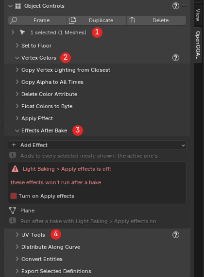

[↑ OpenGOAL Level Tools — User Guide](README.md)

# Object Controls

**OpenGOAL › Object Controls** works on the **whole selection**, whatever it is: actors, checkpoints, meshes,
empties ... It has a row of quick buttons, a summary of what's selected, and sub-panels with tools (all collapsed
at first):

- [Frame, Duplicate, Delete](#frame-duplicate-and-delete)
- [The selection summary](#the-selection-summary) (① in the screenshot)
- [Set to Floor](#set-to-floor)
- [Vertex Colors](#vertex-colors) (② and ③ in the screenshot)
- [UV Tools](#uv-tools) (④ in the screenshot)
- [Distribute Along Curve](#distribute-along-curve)
- [Convert Entities](#convert-entities)
- [Export Selected Definitions](#export-selected-definitions)

The tools that move or change objects work in Object Mode (the UV Tools also in Edit Mode) and can be undone
with Ctrl+Z.

## Frame, Duplicate and Delete

The top row of the panel. It is greyed out while nothing is selected (the panel then only says **Nothing
selected**).

| Button | What it does |
|---|---|
| **Frame** | Zooms the 3D view onto the selected objects (Blender's View › Frame Selected). |
| **Duplicate** | Duplicates the selected objects in place. Same as Blender's **Shift+D**, without the move afterwards. |
| **Delete** | Deletes the selected objects. Same as Blender's **X** › Delete. |

Both buttons and Blender's own Shift+D / X take care of the add-on's objects:

- **Copies get proper names.** A copied actor is named like a newly spawned one (`ACTOR_babak_3`, not
  `ACTOR_babak_0.001`); checkpoints, cameras and ambients get their next free name too
  (`CHECKPOINT_myl_cp2`, `CAMERA_4`, `AMBIENT_snd005`). Their copied helper empties (`_CAM`, `_ALIGN`,
  `_PIVOT`, `_LOOKAT`) follow the new name, and copied actors get their own preview model.
- **Deleting cleans up.** Deleting an actor, checkpoint, camera or ambient also deletes its preview, its helper
  empties and the volume links that pointed at it.

## The selection summary

Under the buttons is a collapsed line such as **12 selected (8 Actors, 3 Waypoints, 1 Meshes)** (① in the
screenshot). Click it to open the list of the selected objects, grouped by kind.

Each kind (and each object under it) has two small buttons:

| Button | What it does |
|---|---|
| Arrow (select) icon | **Select only** this kind / this object: everything else is deselected. |
| **X** | **Remove** this kind / this object from the selection. |

This is handy after a box select: open the list and keep only the actors, or drop the waypoints you caught by
accident. Up to 40 objects are listed per kind; the rest show as **… +N more**.

The kinds, in the order they are listed:

| Kind | Which objects |
|---|---|
| **Actors** | `ACTOR_` objects. |
| **Waypoints** | Path waypoints. |
| **Checkpoints** | `CHECKPOINT_` objects (not their `_CAM`). |
| **Cameras** | Camera objects and camera helpers (`_CAM`, `_ALIGN`, `_PIVOT`, `_LOOKAT`). |
| **Trigger volumes** | `VOL_` objects. |
| **Load boundaries** | `LOADBND_` objects. |
| **Nav-meshes** | Nav-mesh meshes. |
| **Ambients & hints** | `AMBIENT_` objects. |
| **Meshes**, **Curves**, **Empties**, **Lights** | Other objects of that Blender type. |
| **Previews** | Actor and waypoint preview models. |
| **Other** | Anything else. |

See [Object names](interface.md#object-names) for what the prefixes mean.

## Set to Floor

Drops the selected objects onto the ground straight below them: orbs on a path, crates, enemies you placed
roughly, plants on a slope ...

1. Select the objects. Put them roughly above (or a little inside) the ground.
2. Open **Object Controls › Set to Floor** and set the options.
3. Click **Set N to Floor**.

The ground is any object hit straight below, except trigger volumes, load boundaries, nav-meshes, previews and the
selected objects themselves. Children of a selected object move with their parent. If nothing is found below
some objects, they stay put and their names are reported.

| Option | Default | What it does |
|---|---|---|
| **Distance** | 0 | Height above the ground, e.g. for floating orbs. |
| **Search from above** | 1 m | The search starts this far above the object, so one slightly under the ground still finds it. |
| **Align to floor** | off | Tilts the object so its up axis follows the ground's slope (it keeps its turn). **Distance** is then measured along the slope's up direction. |
| **Meshes** | Lowest vertex | For meshes only: **Lowest vertex** puts their lowest point on the ground, **Origin** puts their origin there (like empties and actors). |
| **Set N to Floor** | | Does it. N is the number of selected objects (previews not counted). |

## Vertex Colors

**Object Controls › Vertex Colors** (② in the screenshot) holds tools for the baked vertex colours of the selected
meshes: **Copy Vertex Lighting from Closest**, **Copy Alpha to All Times**, **Delete Color Attribute**, **Float
Colors to Byte**, **Apply Effect** and **Effects After Bake** (③, effects that run after every bake). Most of them
change `BakedLight` and every time of day layer at once.

They are explained in full on the Lighting page: [Vertex Colors tools](lighting.md#vertex-colors-tools).

## UV Tools

**Object Controls › UV Tools** places the texture coordinates (UVs) of the selected meshes, in ways that suit
level geometry. It has three sub-panels: **Fit Faces on UV**, **Cube Project** and **Randomize UV**.

- In **Object Mode** a tool changes every face of the selected meshes; in **Edit Mode**, only the selected faces.
- It writes the mesh's active UV map (a mesh without one gets a new `UVMap`).
- Faces are oriented in the world: on walls the texture stands upright, on floors and ceilings it follows the world
  X and Y axes.
- Ctrl+Z undoes it. The button shows how many meshes it will change.

### Fit Faces on UV

Puts each face on the whole UV square, so one face shows the whole texture once: bricks, crates, panels ...
Quads take the 4 corners. Triangles take 3 corners, with their largest angle on the (0, 0) corner. N-gons (5 or
more corners) are left as they are.

| Option | Default | What it does |
|---|---|---|
| **Placement** | Spread | **Spread**: connected faces stay connected, each on its own square, like tiles on a grid. Faces are first grouped by which side they face (as in a cube projection), so a mesh with depth still works. The groups are placed in a row with an empty tile between them, so you can tell them apart in the UV Editor. **Overlap**: every face on the same 0-1 square. |
| **Triangles as Quads** | off | Two triangles that share their longest edge take the 4 corners together, like the quad they were cut from. |
| **Scale** | 1.0 | Scales the whole result. 2 repeats the texture twice across each face. |
| **Rotation** | 0° | Rotates the whole result, e.g. 90° to turn the texture sideways. |
| **Pivot** | Corner | The point Scale and Rotation turn around: **Corner** (0, 0) or **Center** (0.5, 0.5). |
| **Fit Faces (N meshes)** | | Does it. |

### Cube Project

Projects each face along its closest world axis (X, Y or Z), at the same scale everywhere: a quick way to texture
walls, floors and blocks so the texture has the same size on all of them and lines up between separate meshes.

| Option | Default | What it does |
|---|---|---|
| **Texture Size** | 4 m | The texture repeats every this many metres. |
| **Cube Project (N meshes)** | | Does it. |

Each group of connected faces is then moved by whole tiles next to the UV origin, so a mesh far from the world
centre doesn't end up with huge UV numbers. Because the texture repeats, this doesn't change how it looks.

### Randomize UV

Moves every UV point a little, at random, to break up a texture that repeats too visibly. Faces that are connected
in the UV stay connected (in Edit Mode, a point shared with an unselected face moves that face's corner too).

| Option | Default | What it does |
|---|---|---|
| **Max Distance** | 0.05 | How far a point can move, in UV units (1 = the whole texture). |
| **Seed** | 0 | Change it for another random result. |
| **Randomize (N meshes)** | | Does it. Each click with the same seed moves the points again. |

## Distribute Along Curve

Places the selected objects along a curve: a line of orbs, a ring of crates, fence posts along a road ... Any
objects work. This moves real objects, unlike [Sync's distribute](paths-and-platforms.md#distribute-along-the-path),
which spreads copies of one platform in time along its path.

1. Draw a curve (Add › Curve), or use an existing one.
2. Select the objects to place, then the curve last (Ctrl+click), so it is the active object. This fills in
   **Curve**. You can also pick it in the field.
3. Choose a **Method** and, if you want, an **Align** axis.
4. Click **Distribute N**.

The objects are placed **in name order** (`orb_2` before `orb_10`), the first at the curve's start. Only the
curve's first spline is used. The curve itself, other curves, previews and children of selected objects are not
moved. A closed (cyclic) curve spreads the objects all the way round.

| Option | Default | What it does |
|---|---|---|
| **Curve** | | The curve to use. Making a curve the active object fills it in. The pencil button makes the curve active and goes into Edit Mode on it (the selection stays). |
| **Method** | Distance | **Distance**: the same distance along the curve between the objects, first to last end. **Per segment**: each stretch between two curve points gets the same share of the objects whatever its length, so points close together pack the objects closer. **Fixed spacing**: one object every **Spacing** metres from the curve's start, stopping at its end. |
| **Spacing** | 2 m | Fixed spacing only: the distance between two objects along the curve. |
| **Align** | No Align | **No Align** keeps the objects' rotation. **X**, **Y**, **Z**, **-X**, **-Y**, **-Z**: that axis of the objects follows the curve; up stays up. |
| **Distribute N** | | Does it. N is the number of objects that will move. With Fixed spacing, objects that don't fit before the curve's end stay where they are and are reported. |

Run it again after editing the curve or changing the options; the objects just move to the new places.

## Convert Entities

Turns the selected objects into actors of another type, keeping where they are: swap a row of `babak`s for
`lurkercrab`s, turn placeholder empties or meshes into crates ...

1. Select the objects.
2. Open **Object Controls › Convert Entities** and pick **Convert** (what gets converted, see below).
3. Next to **Target actor**, click **Pick…** and search for the actor type (listed as "Name (etype)").
4. Click **Convert N ... to <type>**.

Each converted object is replaced by a new actor spawned at the same place, with the same rotation and a fresh
name, as if you had spawned it. What still applies is kept: paths, entity and volume links, nav-mesh link,
settings, custom lumps. Links from other objects to the old object now point at the new actor. The old object and
its preview are deleted, and the new actors are selected.

| Option | What it does |
|---|---|
| **Convert**: **Actors only** (default) | Only the selected actors are converted. |
| **Convert**: **Actors and empties** | Plain empties become actors too. |
| **Convert**: **All objects** | Meshes, curves and other objects are replaced by actors too. Those objects are **deleted**; the panel warns you in red. Use Ctrl+Z if that wasn't what you wanted. |
| **Target actor** | The actor type to convert to. **Pick…** opens a search of every spawnable actor. |
| **Convert N ... to <type>** | Does it. N is the number of objects that will be converted. |

Never converted, whatever the mode: waypoints, checkpoints, cameras and their helpers, ambients, trigger volumes,
load boundaries, nav-meshes, previews, and children of other selected objects.

## Export Selected Definitions

Writes the selected objects as text, exactly the way the level export writes them. Use it to:

- copy objects to another .blend: export, then in the other file use
  [Import › From GOAL Files](importing.md#from-goal-files) (**Paste from Clipboard**, **Import**),
- paste them into a level made without the add-on, or a hand-written file,
- share a setup with someone.

1. Select the objects (actors, cameras, checkpoints, load boundaries, nav-meshes).
2. Open **Object Controls › Export Selected Definitions** and set the options.
3. Click **Export N Definition(s)**. The text is always copied to the clipboard, and also written to **Write to**
   if it's set.

What each kind gives:

| Selected | What is written |
|---|---|
| Actors | Their entries for the level `.jsonc` `"actors"` list, the `"art_groups"` they need, and the `.gd` files they need (code first, then texture pages and art groups). |
| Cameras | Their entries for the level `.jsonc` `"cameras"` list. Only with the built-in camera system (see [Cameras](cameras.md) and **Camera system** in [Developer Tools](developer-tools.md#build-settings)). |
| Checkpoints | Their continue-points for `level-info.gc` (inside `:continues`). |
| Load boundaries | Their forms for `load-boundary-data.gc`. |
| Nav-meshes | Selected nav-meshes, and the ones linked to selected actors, written for the [nav-mesh system](enemies-and-navmesh.md#nav-mesh-system) in use: entries for `entity.gc`, or a `-nav.gc` definition for custom-nav. |

Other selected objects are skipped. The text starts with a line naming the level and how many objects were
selected.

| Option | Default | What it does |
|---|---|---|
| **Write to** | empty | A text file (rewritten each export) or a folder (a new `og-definitions-<date>-<time>.txt` each export). Empty: clipboard only. |
| **Add comments** | on | The `;;` lines saying what each part is and where it goes. |
| Format | Bracket | How the `.jsonc` lists are written: **Bracket & category** (`"actors": [ ... ]`), **Bracket** (`[ ... ]`), or **No brackets** (only the entries, to paste between other entries of a list). |
| **End with a comma** | on | Only with No brackets: a comma after the last entry, to paste between other entries. Turn it off when pasting as a list's last entry. |
| **Indentation offset** | 1 | Extra indentation of the `.jsonc` parts, in steps of 2 spaces (0-8). At 1, entries line up inside a level file's `"actors"` / `"cameras"` list. |
| **Export N Definition(s)** | | Exports. N counts the selected actors, checkpoints, cameras and load boundaries. |

---
[← Previous](lighting.md) · [Guide index](README.md) · [Next →](tasks.md)
