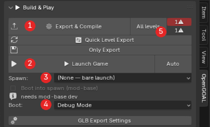

[↑ OpenGOAL Level Tools — User Guide](README.md)

# Troubleshooting

This page explains every warning the add-on shows, what the Level Audit checks, the usual reasons the game crashes,
build errors, and common questions. For words you don't know, see the [Glossary](glossary.md).

---

## Warning counts: red and grey ⚠

The add-on checks every actor of the active level and shows the result as counts:

- next to **Export & Compile** (⑤ in the [Build & Play screenshot](images/build-play.png)), for the whole level,
- in the header of the actor's panels in **Object Settings** (② in the [actor screenshot](images/actor.png)), for the
  selected actor, per panel (links, path, nav-mesh ...).

There are two kinds:

| Count | Means | Build |
|---|---|---|
| **Red N⚠** (required) | Something the actor needs is missing. In game it may not work, or crash. | Still builds, but fix these first. |
| **Grey N⚠** (soft) | It works, but this setup makes it do less than it could (it idles, stays silent ...). | Fine, if that's what you want. |

Hover a count to see the list. Click it to open a popup: for a red count on an actor the popup has the missing
fields themselves, so you can fill them in right there. The level count lists the actors; click a name to select it.

The counts update after every edit (moving objects doesn't count as an edit).

### Red: required

| Warning text | Meaning | Fix |
|---|---|---|
| *a field's name*, e.g. a task or an object field | A field the database marks as required is empty: a **task** field with no task, or an **object** field (an empty or a `CAMERA_` the actor uses) with nothing picked or a deleted object. | Pick a task / object in the popup or in the actor's panel. |
| *&lt;lump key&gt;* or *&lt;lump key&gt; (&lt;label&gt;)*, e.g. `alt-actor (...)` | A required **link** slot is empty, or points to an object that no longer exists. | Link the right actor (popup, or **Entity Links**, see [Actors](actors.md)). |
| *&lt;path name&gt;: &lt;help&gt;* or *&lt;path name&gt; (path)* | The actor needs a path (`path`, `pathb` ...) and has none. Not shown when the actor reads its paths from another actor (`path-actor` link). | Add a path: popup or **Path** panel (see [Paths & platforms](paths-and-platforms.md)). |
| **nav-mesh: no triangles** | The linked nav-mesh has no faces. | Give the mesh faces, or link another one. |
| **nav-mesh: N triangle(s) with no area or standing up (skipped)** | Some nav-mesh faces are flat lines or vertical; they're left out. | Delete or fix those faces. |
| **nav-mesh: N triangles: the game allows 255 at most** | Too many faces for one nav-mesh. | Simplify it (decimate / Reduce) or split it into several meshes. |
| **nav-mesh: N vertices: the game allows 255 at most** | Too many vertices. | Same as above. |
| **nav-mesh: only jump (gap) triangles: needs walkable ones** | Every face has the jump material. | Give the walkable faces the normal nav material. |
| **nav-mesh: N edge(s) shared by 3+ triangles (only 2 are joined)** | An edge with three or more faces on it; enemies only cross between two of them. | Fix the mesh so each edge has at most two faces. |
| **sound bank &lt;bank&gt; (for &lt;sound&gt;)** | A sound emitter or particle spawner plays a sound from a bank the level doesn't load (only `common` and the level's two sound banks are loaded). | Set that bank in **Level › Settings › Sound & Music**, or pick another sound. See [Audio](audio.md). |

Nav-mesh fixes are on the [Enemies & nav-meshes](enemies-and-navmesh.md) page.

### Grey: soft

| Warning text | Meaning | Fix |
|---|---|---|
| **nothing sends it 'trigger: it stays put (link it from a button's notify list)** | This actor only starts moving when something sends it `trigger`, and nothing does. | Link it from a button (or another sender) — or leave it if it should never move. |
| **sound bank &lt;bank&gt; not loaded: no &lt;sounds&gt;** | The actor's own sounds are in a bank the level doesn't load, so they're silent. | Load that bank (**Level › Settings › Sound & Music**). |
| **no nav-mesh: it idles / notices Jak but can't pathfind** | A nav-enemy with no nav-mesh. It doesn't crash (the add-on gives it a tiny stand-in mesh) but it can't chase or patrol. | Link a nav-mesh (see [Enemies & nav-meshes](enemies-and-navmesh.md)). |
| **nav-mesh: N separate parts: enemies can't path from one to another** | The nav-mesh is in pieces that don't share edges. | Join the parts, or use one mesh per area on purpose. |
| **nav-mesh: N jump area(s) not joining two walkable areas: enemies stop at them** | A jump area should link two walkable areas; this one doesn't. | Connect both sides of the jump area to walkable faces. |
| Actor-specific texts | Some actors have their own soft warnings, written in the database. Examples: **no Flut Flut egg linked: she only appears at her task's need-reward-speech (vanilla)**, **no Bird Lady (Beach) links this egg and Spill cell is off: its cell never comes**. | Do what the text says, or leave it. |

---

## Level Audit

**Level › Level Audit** (⑥ in the [Level screenshot](images/level.png)) checks the whole active level at once, with more
checks than the warning counts. Click **Run Audit**. The header then shows **NE NW** (errors and warnings), and each
result is a box with its severity, the message and a select button that selects and frames the object.

Run it before you share a level, and when the game crashes and you don't know why.

| Severity | Meaning |
|---|---|
| **ERROR** | Will most likely break: a crash, a missing object, something that can't work. |
| **WARNING** | May not work as you expect. |
| **INFO** | For your information (the last one is always a summary of the level). |

### Audit messages

**Nav-meshes and enemies**

| Message | Fix |
|---|---|
| ERROR **Nav-enemy '…' (…) navmesh link '…' does not exist in the scene.** | The linked nav-mesh was deleted or renamed: link it again. |
| ERROR **'…' (…) uses the nav-mesh of '…', which has no navmesh link.** | The actor copies the nav-mesh of another actor (`nav-mesh-actor`) that has none: give that one a nav-mesh. |
| WARNING *every grey soft warning above*, as **'actor' (etype): text** | See the soft table. |

**Paths and links**

| Message | Fix |
|---|---|
| ERROR **'…' (…) requires a … path but has none.** | Add the path. |
| WARNING **'…' (…): required link slot '…' is unset.** | Link the actor it needs. |
| ERROR **'…' (…): link '…' points to '…' which does not exist.** | The target was deleted or renamed: link again or remove the link. |
| WARNING **'…' (…): link '…' → '…' (…) is not an expected type (…). It may not work in game.** | The linked actor is a type this slot doesn't expect. Check it's the right one. |

**Volumes and cameras**

| Message | Fix |
|---|---|
| WARNING **Trigger volume '…' has no links. It will export as dead weight.** | Link it to something, or delete it. |
| WARNING **Volume '…' has a link with an empty target name.** | Remove the empty link. |
| ERROR **Volume '…' links to '…' which does not exist.** | Re-link or remove it. |
| WARNING **Volume '…' links to '…' which is named like a camera but is not a Camera object.** | Use a real camera (spawned from **Spawn Objects**). |

**Checkpoints and doors**

| Message | Fix |
|---|---|
| ERROR **No checkpoint named "start". The level has no player start position (Build & Play spawns at &lt;level&gt;-start).** | Add a checkpoint named `start` (see [Level flow](level-flow.md)). |
| WARNING **'…' (launcherdoor) has no continue-name set. …** | Set the checkpoint the door activates. |
| ERROR **'…' (launcherdoor) continue-name '…' does not exist in the scene.** | Pick an existing checkpoint. |
| INFO **'…' (…): state-actor target '…' is a '…', not a basebutton. …** | Usually fine; a basebutton is the normal controller for eco doors. |
| WARNING **'…' (basebutton) has no notify actor or chain and no door uses it as state-actor. The button will animate but trigger nothing.** | Link what the button should open / trigger. |

**Names**

| Message | Fix |
|---|---|
| ERROR **N actors export as '…' (…). The engine resolves actors by name — duplicates cause wrong-entity lookups.** | Rename one of them. |
| WARNING **'…' has a Blender copy name: rename it (or duplicate with Shift+D / the addon's Duplicate).** | A `.001` name: rename it. |

**Actor setup**

| Message | Fix |
|---|---|
| ERROR **'…' needs at least one spawn path (patha .. pathh) — Path panel > Add Path.** | A battlecontroller needs a path to spawn its lurkers on. |
| WARNING **'…': Spawn chances add up to X, not 1.0.** | Make the battlecontroller's lurker chances add up to 1. |
| WARNING **'…': Only the first N lurkers are used.** | Remove extra lurker types. |
| ERROR **'…': the custom camera needs a camera art group and an animation.** | Fill in both, or use another camera variant. |
| ERROR **'…': the citadel camera needs a camera position (…) — the game crashes without it.** | Add the camera position empty. |
| WARNING **N citadel-camera battlecontrollers: they all use the one '…' position (the first one exported).** | Expected; only one position exists. |
| WARNING **…: its local X/Y/Z axis (game) points straight up/down, so it won't work. Rotate it …** | Rotate the actor (a swingpole's pole must lie flat). |
| ERROR **…: sync period X s crashes the game (divide by zero). Use at least 0.01 s (negative turns the other way).** | Raise the sync period. |
| WARNING **…: … only show with the texture source … (Level settings; this level uses …). They stay blank otherwise.** | Set **Level › Settings › Visuals › Texture source** to one of the listed levels (see [Levels](levels.md)). |
| WARNING **Custom audit check for '…' raised: …** | An add-on check failed: please report it. |

**Sound, files, geometry, load boundaries**

| Message | Fix |
|---|---|
| WARNING **…: sound '…' is in the … sound bank, which this level doesn't load (…). Set it as one of the level's sound banks or it won't play.** | Load the bank (**Level › Settings › Sound & Music**). |
| INFO **Particle file … is also used by vanilla …: if both levels are loaded at the same time, unloading one can break the other's particles.** | Only matters if your level is loaded next to that vanilla level. |
| WARNING **N mesh(es) outside the Geometry collection aren't exported (…). Build & Play > Move to Geometry.** | Click **Move to Geometry** in Build & Play, or move them yourself (see [Geometry](geometry.md)). |
| ERROR **'…': Top (X m) must be above Bottom (Y m). The boundary wall has zero or inverted height.** | Fix the load boundary's Top / Bottom (see [Volumes & triggers](volumes-and-triggers.md)). |
| WARNING **Audit check '…' raised an unexpected error: …** | An add-on bug: please report it with the message. |
| INFO **Scene: N actor(s) (…), N volume(s), N camera(s), N checkpoint(s), N spawn(s).** | A summary. |

### Other warnings in the panels

| Where | Text | Meaning |
|---|---|---|
| Level › Settings | **Name too long (N/10 chars)** | Level names can have 10 characters at most; the build refuses longer ones. |
| Level › Settings | **Level index N collides with another level** | Two levels have the same **Level Index**. Give each a unique one (100 and up). |
| Level › Settings | **Nickname '…' collides with another level** | Two levels have the same 3-letter vis nickname. Set a unique **Vis Nickname**. |
| Level › Settings | **'…' already has level files (another .blend?): exporting overwrites them** | Another level with this name was exported before. Rename yours unless you mean to replace it. |
| Level › Settings › Sound & Music | **Bank 1 and Bank 2 are the same** | Pick two different banks (or none). |
| Build & Play | **N mesh(es) outside Geometry aren't exported** | Click **Move to Geometry**. |
| Build & Play | **Missing paths — open Developer Tools** | `gk`, `goalc` or `game.gp` wasn't found: check the paths ([Developer Tools](developer-tools.md)). |

---

## The game crashes

The most common reasons, roughly from most to least likely:

**A required link or field is missing.** Many actors read another actor, a path or a camera when they start; with
nothing there they crash. Fix every red ⚠ and every audit ERROR.

**A broken nav-mesh setup.** A nav-enemy with *no* nav-mesh doesn't crash (the add-on gives it a stand-in, it just
idles), but a nav-mesh link to a deleted mesh, or an actor copying the nav-mesh of an actor that has none, does.
Run the Level Audit.

**Out of memory while loading (`kmalloc: !alloc mem data-segment` in the game's log).** Every actor brings the
textures (tpages) of the vanilla level it comes from, and the game has limited memory for a level while it loads. If
you see this error, too many textures is a likely cause: try removing actors from some of the vanilla areas (and
check how many textures your own geometry uses). The Spawn Objects list shows each actor's texture group in
parentheses after its name, so you can see where it comes from (see [Actors](actors.md)).

**Level index or nickname clash.** Each level needs its own **Level Index** and **Vis Nickname**, different from
every other custom level and from the vanilla levels. A clash makes the game load or look up the wrong level. Fix
the red warnings in **Level › Settings**.

**The level sits on top of a vanilla level's load boundaries.** The game boots into Sandover Village (village1)
and the vanilla load boundaries stay active. A level built around the origin can overlap them, so walking through
your level fires their commands (loading or unloading vanilla levels), which can unload your level or run out of
memory. Move your level well away from the origin. To see where the vanilla boundaries are, import the game's
`load-boundary-data.gc` with **Import › From GOAL Files** (see [Importing](importing.md)). A few kilometres is plenty: the add-on's own tests place levels about 3000 m away on X.

**Actor-specific settings.** A sync period of 0 (divide by zero), a battlecontroller citadel camera without its
position... The audit catches the known ones.

**Still crashing?** Start the game with **Build & Play › Boot › Debug Mode (attached debugger)**: a crash while
booting stops in GOALC's debugger and its console shows where. The game's log is in **Developer Tools › Quick Open ›
Game logs**. Try removing recently added actors to find the culprit.

---

## Build errors

The build runs in the background; its messages show in Blender's status bar.

| Message | Cause | Fix |
|---|---|---|
| **Enter a level name first** / **No level in this file** | No active level, or it has no name. | Create or pick a level ([Levels](levels.md)). |
| **Level name '…' is N chars — max 10** | The name is too long. | Shorten it in **Level › Settings**. |
| **GLB export failed: …** / **Export failed: …** | Blender couldn't export the geometry or write a file. | Read the message; the system console has the details (see [Developer Tools](developer-tools.md)). |
| **GOALC failed to start: goalc not found at …** | The EXE path is wrong. | Fix the paths (**Developer Tools › Paths**). |
| **GOALC failed to start: GOALC started but nREPL not available** | GOALC opened but the add-on couldn't talk to it. | Close every GOALC window and build again. A firewall may block local connections. |
| **Compile failed — see the GOALC console** | GOALC found an error in the generated code (or your own GOAL code). | Scroll up in the GOALC window to the first red error. Often the file and line point at your level's `-obs.gc` or an edited actor's code. **Clean Files** and a rebuild fix errors from old files. |
| **Compile didn't finish (GOALC closed or timed out) — check the GOALC console** | GOALC was closed or crashed during the compile. | Look at the GOALC window, then build again (a new GOALC starts). |
| **GOALC isn't running. Run Export & Compile first …** | **Launch Game** needs a running GOALC. | Click **Export & Compile** first. |
| **GK launch failed: …** | The game couldn't start. | Check the EXE path; close any stuck game window. |
| **Tasks: …** | A custom task has a problem. | See [Tasks](tasks.md). |

Notes:
- The first build after GOALC starts compiles all the game code and takes much longer. Later builds only compile what
  changed (the status line says how many targets were rebuilt).
- When your level's code changes a type, the add-on restarts GOALC itself (**Level types changed — restarting
  GOALC...**), because a running GOALC would fail with "Inconsistent type definition".
- After updating the add-on, restart GOALC once.

---

## FAQ

**Q: I don't spawn in my level / I end up in the village.**  
A: The level needs a checkpoint named `start`; **Build & Play** spawns there. With **Launch Game**, pick a checkpoint in
the **Spawn** drop-down (**(None — bare launch)** only starts the game). In **Retail Mode** there's no spawn: set
**Level › Project Settings › Retail Boot Checkpoint**. See [Build & Play](build-and-play.md).

**Q: My changes don't show up in game.**  
A: **Quick Level Export** only writes the level's own files: checkpoints, load boundaries, nav-meshes (`entity.gc`) and
`game.gp` are only updated by **Export & Compile**. If files seem stale, use **Developer Tools › Clean Files** and build
again.

**Q: A mesh is missing in game.**  
A: Only meshes in the level's **Geometry** collection are exported. Use **Move to Geometry** in Build & Play.

**Q: A sound doesn't play.**  
A: Its sound bank isn't loaded: see the sound bank warnings above and [Audio](audio.md).

**Q: Some textures are blank (Flut Flut's eyes, water).**  
A: They need a matching **Texture source** in **Level › Settings › Visuals** (the audit tells you which).

**Q: Enemies stand around and don't chase me.**  
A: They need a nav-mesh (grey ⚠ **no nav-mesh**), or their nav-mesh is in separate parts. See
[Enemies & nav-meshes](enemies-and-navmesh.md).

**Q: Launch Game hangs at "Waiting for version...".**  
A: Raise **Developer Tools › Addon Settings › GK Boot Wait (s)**.

**Q: A feature is greyed out and says it needs another OpenGOAL.**  
A: See **Developer Tools › Addon Settings › Versions**. If the detection is wrong, use **Re-check Versions** or
**Overwrite** ([Developer Tools](developer-tools.md)).

**Q: I renamed my level and the old one is still in the game.**  
A: With **Clean renamed levels** on (default) the next export removes the old name's files. Levels left over from other
.blend files are under **Developer Tools › Addon Settings › Leftover levels**.

**Q: Where do I ask for help?**  
A: On the [OpenGOAL Discord](https://discord.gg/VZbXMHXzTv). Include the Level Audit results and the first error from the
GOALC console or the game log.

---

[← Previous](developer-tools.md) · [Guide index](README.md) · [Next →](glossary.md)
